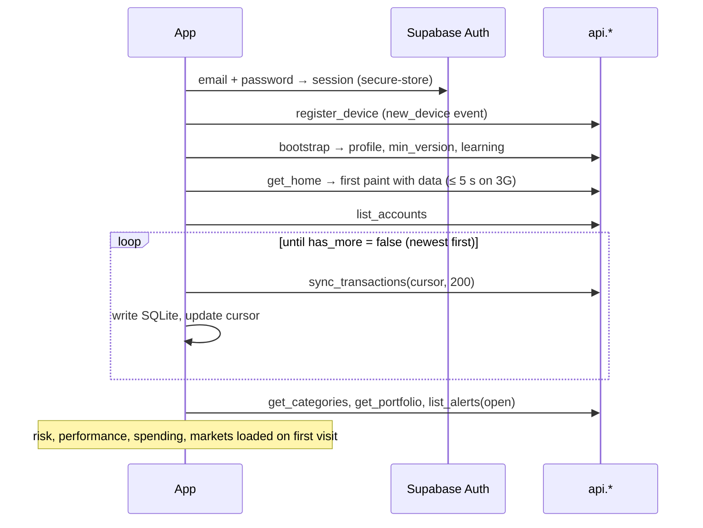

# API contracts and event flows — GOLDENPIECE prototype (Session 2)

Companion of [ARCHITECTURE.md](ARCHITECTURE.md) and
[DATA_MODEL.md](DATA_MODEL.md). Screens refer to
[TECH_ANALYSIS.md](TECH_ANALYSIS.md) §1-§2. JSON Schemas of every
payload will live in `shared/schemas/` (source of the TS and Python
types, written in build session B1).

---

## 1. Common rules

| Rule | Spec |
|---|---|
| Transport | HTTPS; PostgREST `POST /rest/v1/rpc/<name>` (schema `api`) or Edge Function `POST /functions/v1/<name>`; gzip on |
| Auth | `Authorization: Bearer <user JWT>`; publishable key in `apikey` |
| Envelope (screen RPCs) | `{ "etag": "…", "as_of": "2026-12-01T08:00:00Z", "not_modified": false, "data": {…} }`; when the caller's `p_etag` matches → `{ "etag": "…", "not_modified": true }` (≈ 60 B) |
| Money in payloads | `{ "m": 250000, "c": "XOF" }` (minor units + currency). Each screen payload also returns `ref` values already converted to the user's reference currency (`"r": 250000`) so the phone does no FX for server-computed totals; the phone converts only for display switches (peg + `fx` block) |
| Dates | ISO 8601 UTC; local dates as `YYYY-MM-DD` in the user's zone |
| Reason codes | alerts and scores return `{code, params}`; texts live in `shared/i18n` (FR/EN), so the server never sends prose |
| Errors | `{ "error": { "code": "CONFLICT|REJECTED|RATE_LIMITED|NOT_FOUND|FORBIDDEN|MIN_VERSION|INVALID", "message_key": "…", "retry_after_s": 30 } }` |
| Pagination | keyset: `p_cursor` (opaque) → `next_cursor` or null |
| Idempotency | every mutation carries `p_client_id` (UUID v7); a repeat returns the stored result |
| Timeouts (app) | 15 s, 2 retries with backoff (TECH_ANALYSIS §6) |
| Size column below | typical gzip size at demo data [assumed, measured in B6] |

---

## 2. Contracts per screen

### 2.1 Launch and onboarding (TECH_ANALYSIS §1)

| Screen | Call | Request | Response `data` (fields) | Size |
|---|---|---|---|---|
| Splash / health | `api.health_public()` (anon) | — | `status`, `min_version`, `maintenance` | 0.1 KB |
| Country picker | `api.countries(p_lang)` (anon; also bundled in the app, call only refreshes) | `p_lang` | `[{iso2, name, dial_code, profile_id, timezones[], operators[]}]` | 6 KB (bundled) |
| Legal texts | `api.legal_texts(p_lang)` (anon) | | `[{kind, version, body_md}]` | 8 KB |
| Guided tour | none (bundled JSON demo data, works offline) | — | — | 0 |
| Continue in demo | Edge `account-demo-start` | `{persona: 'dakar_salaried'|'abidjan_trader'|'diaspora_investor', lang, country}` after `auth.signInAnonymously()` | `{user_id, persona, accounts_count}` (clone in < 2 s) | 0.2 KB |
| Sign-up | Supabase Auth `signUp(email, password)` → e-mail OTP → `verifyOtp` | | session | — |
| Device registration | `api.register_device` | `{p_device_id, label, platform, os_version, app_version, security_level, unlock_method}` | `{new_device: bool}` (writes `new_device` event) | 0.1 KB |
| Consents | `api.record_consents` | `[{kind, granted, text_version}]` | `{ok}` | 0.1 KB |
| Card scan | `api.save_card` | `{bin6, last4, brand, source}` | `{bank: {id, name} | null, banks_for_country: [{id,name}]}` | 0.5 KB |
| Pick bank | `api.set_card_bank` | `{bank_id}` | `{ok}` | 0.1 KB |
| Questionnaire | `api.save_questionnaire` | `{section, answers, version}` | `{risk_profile?}` | 0.1 KB |
| Link account | Edge `provider-link-start` → `provider-link-complete` | `{institution, scopes}` → `{link_id, approve:true}` | consent descriptor `{institution_name, scopes[], history_days, simulated:true}` → `{accounts:[{id, kind, display_name, currency, balance}]}` | 1 KB |
| Bootstrap (each login/launch online) | `api.bootstrap(p_etag)` | | `profile{language,country,timezone,ref_currency,risk_profile,hide_amounts_in_push,is_demo}`, `min_version`, `learning{active, days, ops}`, `consents_current[]`, `card{brand,last4,bank_name}`, `devices_count`, `flags{}` | 1.5 KB |

### 2.2 Home (§2.1)

`api.get_home(p_etag)` — one call.

| Field | Content |
|---|---|
| `networth` | `{net, assets, liabilities}` in ref currency; `change_day {abs, pct}`, `change_month {abs, pct}`; `as_of` |
| `spark_30d` | 30 points `[date, net]` |
| `alerts` | `{open_count, top: {id, kind, band, score, reason: {code, params}, created_at}}` |
| `budget` | `{month, spent, budgeted, left, worst: {category_id, pct}}` |
| `market_strip` | 5 × `{instrument_id, name, price, change_pct, as_of, delayed: true, proxy_of}` |
| `learning` | `{active, days, ops}` (drives the learning card) |
| `fx` | `{EUR: 655.957, USD: x, XAF: 1}` per 1 unit vs XOF for display switches |

Size ≈ 2.5 KB; `not_modified` most opens.

### 2.3 Accounts and transactions (§2.2)

| Screen | Call | Request | Response | Size |
|---|---|---|---|---|
| Accounts list | `api.list_accounts(p_etag)` | | `[{id, kind, display_name, institution, operator, iban_masked, msisdn_masked, currency, balance, balance_ref, last_sync_at, history_available, simulated:true}]` | 1 KB |
| Account detail (list) | `api.get_transactions` | `{p_account_id?, p_cursor, p_limit=50, p_filters{category_id[], min, max, from, to, q}}` | `items[{id, booking_ts, cdt_dbt_ind, amount, amount_ref, label, cp_name, category_id, category_source, op_type, status, alert_id?}]`, `next_cursor` | 4 KB / 50 rows |
| Sync (offline cache) | `api.sync_transactions(p_cursor, p_limit=200)` | | same row shape + `account_id, row_version, updated_at`; `next_cursor`, `has_more` | 12 KB / 200 rows |
| Pull-to-refresh | Edge `provider-sync` | `{account_ids?}` | `{new_count, balances[]}` (new rows then come by `sync_transactions`) | 0.3 KB |
| Transaction detail | `api.get_transaction(p_id)` | | all ISO fields in plain names: `counterparty{name, iban_masked, msisdn_masked, bic}`, `references{end_to_end_id, tx_id, operator_ref}`, `type_label_key`, `value_date`, `charges`, `momo{op_type, agent_id, balance_after}`, `category{id, source}`, `score{total, band, reasons[]}?`, `similar_count` | 1.2 KB |
| Change category | `api.set_category` | `{p_client_id, p_tx_id, p_category_id, p_base_version, p_create_rule: bool, p_apply_to_similar: bool}` | `{status: applied|conflict, updated_count, rule_id?}` | 0.2 KB |
| Rule preview | `api.preview_rule` | `{p_tx_id, p_category_id}` | `{match: {field, type, pattern}, similar_count, sample[3]}` | 0.6 KB |

### 2.4 Portfolio (§2.3)

| Screen | Call | Request | Response | Size |
|---|---|---|---|---|
| Positions + allocation | `api.get_portfolio(p_etag)` | | `positions[{instrument_id, name, class, currency, qty, avg_cost, last_price, price_as_of, freshness: 'delayed'|'monthly'|'manual', value, value_ref, unrealised, unrealised_pct, realised, proxy_of}]`, `real_estate[{id, name, value_ref, valued_on, stale: bool}]`, `debts[{id, name, balance_ref, rate_bp, monthly_payment}]`, `allocation{class[], currency[], country[]}` (`{key, value_ref, share}`), `totals` | 4 KB |
| Add trade | `api.add_trade` | `{p_client_id, instrument_id, side, trade_date, quantity, price, currency, fees}` | `{status: applied|rejected, reason_key?, position}`; enqueues recompute | 0.3 KB |
| Instrument search | `api.search_instruments(p_q)` | | `[{id, name, class, currency, proxy_of}]` ≤ 20 | 1 KB |
| Real estate | `api.upsert_real_estate`, `api.add_valuation` | `{p_client_id, id, name, country, currency}` / `{p_client_id, real_estate_id, value, valued_on}` | `{status}` | 0.1 KB |
| Debts | `api.upsert_debt` | debt fields | `{status}` | 0.1 KB |
| Asset detail | `api.get_asset(p_instrument_id, p_range '3M'|'1Y'|'5Y', p_etag)` | | `candles[[d,o,h,l,c]]` (≤ 260, LTTB/weekly for 5Y), `stats{last, change_1d, change_1y, vol_ann, beta, benchmark}`, `my_position?`, `attribution_text_key` | 6 KB |

### 2.5 Markets (§2.4)

`api.get_markets(p_etag)` → `groups[{key: 'indices'|'metals'|'energy'|'agri'|'crypto'|'fx', items[{instrument_id, name, price, currency, change_pct, as_of, freshness, proxy_of}]}]`, `attributions[]` (CoinGecko etc.). XOF/XAF rows computed from the peg. ≈ 2 KB.

### 2.6 Spending (§2.5)

| Screen | Call | Response | Size |
|---|---|---|---|
| Month overview | `api.get_spending(p_month, p_etag)` | `by_category[{category_id, spent, prev_month, change_pct}]`, `indicators{savings_rate, reste_a_vivre, fixed_share, mom_change}`, `income`, `uncategorised_count` | 2 KB |
| Flows (Sankey) | `api.get_flows(p_month, p_etag)` | `nodes[{id, kind: income|category|savings, label_key|name}]`, `links[{source, target, value}]` (≤ 25 links; small categories grouped "Autres") | 1.5 KB |
| Budgets | `api.get_budgets(p_month, p_etag)` | `[{id, category_id, amount, spent, pct, state: ok|80|100}]` | 1 KB |
| Edit budget | `api.upsert_budget` | `{p_client_id, category_id, amount, month?, p_base_version}` → `{status}` | 0.1 KB |
| Categories & rules | `api.get_categories(p_etag)` | `tree[{id, parent_id, name, icon, is_user, hidden}]`, `rules[{id, field, type, pattern, category_id, source}]` | 3 KB |
| Edit category / rule | `api.upsert_category`, `api.upsert_rule`, `api.delete_rule` | `{status}` | 0.1 KB |

### 2.7 Risk (§2.6)

`api.get_risk(p_etag)` →

| Field | Content |
|---|---|
| `as_of` | batch date |
| `figures` | `[{metric: vol_ann|beta|var95_1d|cvar95_1d|var95_1m|cvar95_1m|max_drawdown, value, value_ref, n_obs, method_key, status: ok|insufficient}]` |
| `var_details` | `{var95_1m_hist, n_windows}` or null |
| `drawdown` | ≤ 260 points `[d, dd]` |
| `exposures` | `{class[], currency[], country[], sector[]}` |
| `concentration` | `{threshold_pct, breaches[{key, share}]}` |
| `excluded` | `[{name, value_ref, reason: 'real_estate'|'monthly_price'|'insufficient_history'}]` |
| `minimums` | thresholds used (ARCHITECTURE §14) for the "Données insuffisantes" texts |

≈ 4 KB. Concentration threshold edit: `api.set_concentration_threshold(p_pct)`.

### 2.8 Performance (§2.7)

| Call | Response | Size |
|---|---|---|
| `api.get_performance(p_period '1M'|'YTD'|'1Y'|'ITD', p_etag)` | `{period, start, end, twr, irr, annualised, pnl_ref, contributions{instrument[], class[]} ({key, name, avg_weight, return_ref, contribution, currency_effect}), currency_effect_total, status}` | 2.5 KB |
| `api.get_performance_custom(p_from, p_to)` | same shape; computed live in SQL (ARCHITECTURE §14), ≤ 2 years; rate limit 20/user/hour | 2.5 KB |

### 2.9 Alerts centre (§2.8)

| Call | Request | Response | Size |
|---|---|---|---|
| `api.list_alerts(p_status 'open'|'all', p_cursor)` | | `items[{id, kind, band, score, status, reasons[{code, params}], tx{id, amount, cp_name, booking_ts}?, created_at, answered_at, decision{value, at}?}]` | 3 KB / 20 |
| `api.get_alert(p_id)` | | + `score_breakdown{a_thr, a_if, f, m}` (for the "Pourquoi ?" sheet), `timeline[{status, at}]` | 1.5 KB |
| `api.answer_alert` | `{p_client_id, p_alert_id, p_answer: 'me'|'not_me', p_device_id}` (after local sensitive-action gate) | `{status: confirmed_by_user|escalated, already_answered?: bool}` | 0.2 KB |
| Realtime | channel `alerts:user` (Postgres Changes on `core.alerts`, RLS) | insert/update rows (same shape as list item) | 0.5 KB/event |

### 2.10 Settings (§2.9)

| Call | Purpose |
|---|---|
| `api.update_settings({ref_currency, language, hide_amounts_in_push, data_saver, lock_delay_s, notif_prefs{security, budgets, markets}})` | settings |
| `api.list_devices()` / Edge `account-revoke-device({device_id})` | devices list, remote sign-out |
| `api.record_security_event({type, details})` | app-side events (whitelist: pin_failed, settings_changed, device_security_changed, sign_out) |
| `api.register_push_token({device_id, token})` | push |
| Edge `account-export()` → `{url, expires_at}` | data export (sensitive action) |
| Edge `account-delete({confirm: 'SUPPRIMER'})` | deletion (sensitive action) |
| Edge `account-demo-reset()` | demo clones only: re-anchor template |
| `api.reset_consent(kind, granted)` | consents |

### 2.11 Offline replay

`api.apply_mutations(p_items jsonb)` — `[{client_id, rpc, args}]` (≤ 20;
`rpc` ∈ set_category, upsert_rule, delete_rule, upsert_budget,
upsert_category, add_trade, upsert_real_estate, add_valuation,
upsert_debt, update_settings) → `[{client_id, status:
applied|duplicate|conflict|rejected, reason_key?, current?}]`.

### 2.12 Bank dashboard (§2.10) — analyst role, aal2

| Call | Response | Size |
|---|---|---|
| `api.analyst_queue(p_status, p_cursor)` | `items[{alert_id, created_at, score, kind, reasons[], user_ref (short hash), country, bank_id, status, age_min}]` | 4 KB / 50 |
| `api.analyst_alert(p_alert_id)` | `alert`, `score_breakdown`, `features`, `tx` (full ISO fields), `history_90d[{booking_ts, amount, cp_name, category_id, score}]`, `security_events_30d[]`, `devices[{label, security_level, created_at}]`, `previous_decisions[]`, `user_answer` | 15 KB |
| `api.analyst_decide({p_alert_id, p_decision, p_comment})` | `{status, param_changes[]}` → push to user | 0.3 KB |
| `api.ops_metrics()` | push latency p50/p95 24 h, score latency, Groq backlog, last batch, quotas used, model eval, funnel counts | 3 KB |
| `api.scoring_params()` / `api.reset_params(scope)` | params + change log | 5 KB |
| Realtime | channel on `core.alerts` filtered by analyst RLS | 0.5 KB/event |

### 2.13 Data budget check

Daily normal use (10 opens, mostly `not_modified`): bootstrap 1.5 +
home 2.5 + 3 screens × 3 KB + 50 new transactions 3 KB + alerts 3 KB
+ overheads (headers, TLS) ≈ **60-150 KB/day** ≪ 1 MB. First sync:
bootstrap + home + accounts + 12 months (≈ 2,200 rows = 11 pages ×
12 KB) + portfolio + categories ≈ **160 KB** ≪ 2 MB (the bundled
country list, fonts and tour data are in the APK).

---

## 3. Edge Functions (server-to-server)

| Function | Called by | Contract |
|---|---|---|
| `provider-tick` | pg_cron (every minute, only if due entries) | `{link_ids?}` → materialises due template entries + security events → `ingest` |
| `ingest` | provider-* (in-process module, also HTTP for callbacks) | `{user_id, account_id, entries: ProviderEntry[]}` → `{inserted, scored, alerts}` |
| `categorise-llm` | pg_cron every 5 min if backlog | batch ≤ 40, Groq JSON mode, writes `category_source='ai'` |
| `market-refresh` | pg_cron (*/10 crypto, */15 quotes, hourly FX) | `{kind}` → upserts `mkt.*`, bumps `mkt.version` |
| `market-eod` | pg_cron 22:30 UTC Mon-Fri; FRED 14:00 UTC daily | daily bars, Frankfurter, FRED |
| `notify` | pg_net from `api.analyst_decide`, reminders, budget alerts | `{user_id, alert_id, kind}` → Expo push (amount hidden unless setting) |
| `dispatch-batch` | pg_cron 02:00 UTC + every 5 min if `ops.recompute_queue` not empty | GitHub `POST /repos/Johnfrancis6/GOLDENPIECE/actions/workflows/<file>/dispatches` |
| `simulated-analyst` | pg_cron every 2 min (S2-4, accepted) | decides escalated alerts of persona-based users older than 10 min from ground truth, `simulated=true` |
| `account-cleanup` | pg_cron 03:00 UTC | deletes expired demo clones, exports, old rows (DATA_MODEL §5) |
| `health` | UptimeRobot | `200 {ok}` / `503 {failing:[…]}` |

---

## 4. Event flows (sequence diagrams)

### 4.1 New transaction → categorise → score → alert/push → answer → bank → tuning

```mermaid
sequenceDiagram
  autonumber
  participant CR as pg_cron
  participant PT as provider-tick
  participant SIM as sim (templates)
  participant IN as ingest
  participant DB as Postgres core/ops
  participant ST as Storage (IF model)
  participant EX as Expo Push → FCM
  participant APP as App
  participant RT as Realtime
  participant AN as Analyst dashboard
  CR->>DB: due entries since watermark?
  CR->>PT: pg_net POST (only if > 0)
  PT->>SIM: read entries anchor+offset ≤ now
  PT->>IN: ProviderEntry[]
  IN->>DB: upsert transactions (ingested_at = t0)
  IN->>DB: rule + keyword categorisation (no LLM here)
  IN->>DB: features (SQL fn: profiles, velocity, security events)
  IN->>ST: model JSON (cached per isolate)
  IN->>IN: A_thr, A_if, F, M → S, band
  IN->>DB: insert score; if S ≥ 40 insert alert
  alt band = ask (40-70)
    IN->>EX: push "C'est bien vous ?" (amount hidden), actions Oui/Non
    IN->>DB: alerts.push_sent_at (t1; t1 − t0 ≤ 5 s p95)
    DB-->>RT: alert insert → app if foreground
    APP->>APP: tap action → open app → sensitive-action gate
    APP->>DB: api.answer_alert(me | not_me)
    alt me
      DB->>DB: known payee + z0 +0.10 (bounded), param_changes
    else not_me
      DB->>DB: status escalated → analyst queue
    end
  else band = bank (> 70)
    IN->>DB: status escalated
    IN->>EX: push "Opération signalée à votre banque"
  end
  DB-->>RT: escalated alert → dashboard
  AN->>DB: api.analyst_decide(fraud | legit, comment)
  DB->>DB: user z0 ±0.25 (bounded), audit_log, param_changes
  DB->>EX: via notify: "Votre banque a confirmé : …"
  DB-->>RT: status update → app
  Note over DB: Monday batch: rule weights ±3 from 28-day precision (bounded)
  Note over CR: unanswered 15 min → one reminder; stays open, never sent to bank
```

Asynchronous LLM path: rows left `category_source='none'` are picked by
`categorise-llm` within 5 min; the score is **not** recomputed (it
never depended on the LLM category beyond fallback stats).

### 4.2 Market refresh

```mermaid
sequenceDiagram
  participant CR as pg_cron
  participant MR as market-refresh
  participant V as Finnhub / CoinGecko / Twelve Data / Frankfurter / FRED
  participant DB as mkt.*
  participant APP as App
  CR->>MR: kind=quotes (*/15, only symbols whose exchange is open)
  MR->>V: ≤ 12 calls spread ≤ 12/min (Finnhub /quote)
  V-->>MR: prices
  MR->>DB: upsert quotes_latest; mkt.version.etag = hash
  CR->>MR: kind=crypto (*/10) → 1 CoinGecko /simple/price call
  CR->>MR: kind=fx (hourly) → Twelve Data FX; daily 16:30 CET Frankfurter → fx_daily
  CR->>MR: market-eod 22:30 UTC → Twelve Data time_series (1 credit/symbol)
  MR->>DB: ops.job_runs (counts, errors); on 429 → back off, keep stale value
  APP->>DB: api.get_markets(p_etag) on open → not_modified or new payload
```

### 4.3 Nightly batch

```mermaid
sequenceDiagram
  participant CR as pg_cron 02:00 UTC
  participant DF as dispatch-batch
  participant GH as GitHub Actions (Python)
  participant DB as Supabase (pooler, batch_writer)
  participant ST as Storage
  CR->>DF: start
  DF->>GH: workflow_dispatch batch-nightly.yml
  GH->>DB: ops.job_runs start
  GH->>DB: read trades, balances, bars, fx, transactions (incremental)
  GH->>GH: portfolio_daily → networth_daily → risk (vol, beta, VaR/CVaR, drawdown) → exposures
  GH->>GH: performance (1M/YTD/1Y/ITD: TWR, IRR) → attribution (+ currency effect)
  GH->>GH: behaviour profiles (180 d) → learning status → concentration check
  opt Sunday
    GH->>GH: train IF → export JSON → parity test → evaluation (G7)
    GH->>ST: models/iforest/<version>.json
    GH->>DB: model_artifacts (candidate → active if parity + eval ok)
  end
  opt Monday
    GH->>DB: rule-weight update from 28-day precision (bounded, logged)
  end
  GH->>DB: upsert analytics.*; insert concentration / learning_done alerts
  GH->>DB: ops.job_runs finish (items, duration)
  DB->>DB: alerts insert → notify (push)
  Note over GH: failure → GitHub e-mail; health red if last success > 26 h
```

### 4.4 First sync (new device)



### 4.5 Offline queue replay

```mermaid
sequenceDiagram
  participant UI as Screen
  participant OB as SQLite outbox
  participant SY as Sync engine
  participant DB as api.apply_mutations
  UI->>OB: mutation {client_id, rpc, args, base_version}; optimistic local update, badge "en attente"
  Note over SY: reconnect / app open / every 30 s while online
  SY->>OB: read ≤ 20 FIFO
  SY->>DB: apply_mutations(items)
  DB-->>SY: per item applied | duplicate | conflict | rejected
  SY->>OB: delete applied/duplicate
  SY->>UI: conflict → reload server value, toast "modifié sur un autre appareil"
  SY->>UI: rejected → item "refusé" + reason (e.g. sale > quantity held)
  Note over SY: network error → backoff 2 s, 8 s, 30 s, 2 min, then next open
```

### 4.6 Demo start (clone)

```mermaid
sequenceDiagram
  participant APP as App
  participant AU as Auth
  participant FN as account-demo-start
  participant DB as Postgres
  APP->>AU: signInAnonymously()
  APP->>FN: {persona, lang, country}
  FN->>DB: rate limit 5/IP/hour
  FN->>DB: profile (is_anonymous, demo_persona), provider_links, accounts
  FN->>DB: sim.links anchor_at = now (history ends now, future runs on)
  FN->>DB: copy past entries → core.transactions (shifted), trades, real estate, profiles, learning done
  FN-->>APP: ready (< 2 s target)
  Note over DB: first-session guarantee: a 40-70 entry at +3 min, a > 70 next day 10:00 local
  Note over APP: "Créer mon compte" later = upgrade the anonymous user (link e-mail + password, same user_id) — demo data is KEPT (Franco); is_anonymous=false, so the 7-day cleanup no longer applies
```
