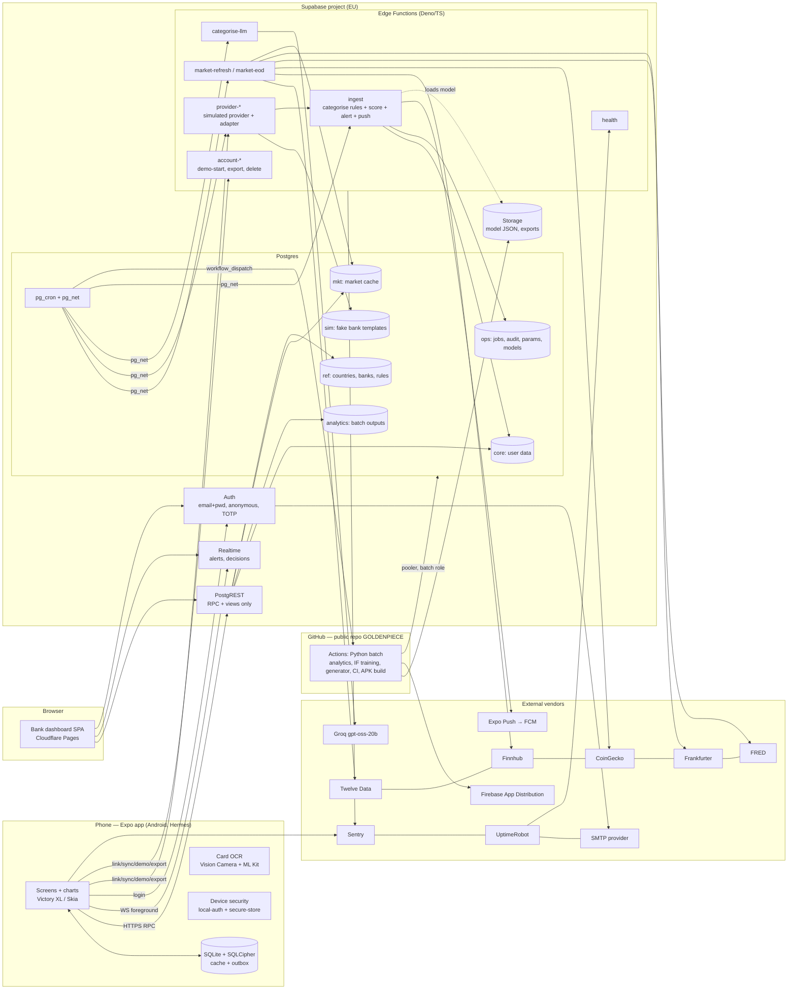

# Architecture — GOLDENPIECE prototype (Session 2)

Input: [MEMOIRE.md](MEMOIRE.md), [TECH_ANALYSIS.md](TECH_ANALYSIS.md),
[TOOLS.md](TOOLS.md), [CHALLENGES.md](CHALLENGES.md) (C1-C10 and Franco's
answers), [SETUP.md](SETUP.md), [BRIEF_02_ARCHITECTURE.md](BRIEF_02_ARCHITECTURE.md).
Companion files: [DATA_MODEL.md](DATA_MODEL.md) (tables, RLS, size),
[API.md](API.md) (contracts per screen, event flows),
[BUILD_PLAN.md](BUILD_PLAN.md) (sessions, deadline),
[BRIEF_03_DESIGN.md](BRIEF_03_DESIGN.md) (design agent).
Decisions questioned in this session: [CHALLENGES.md](CHALLENGES.md),
section "Session 2" (S2-1 … S2-12). Where a section depends on one, it
is tagged (S2-n). Franco answered on 2026-11-22: all accepted except
S2-10, replaced by a free provider without a domain (see CHALLENGES.md).

**Tags:** **[verified]** = read on an official page in Session 1
(2026-11-22, see TOOLS.md); **[assumed]** = my estimate or memory, to
check in the build session named; **[decision]** = validated by Franco;
**[mine]** = architecture decision taken here (Franco may overrule).

**Region:** **eu-west-1 (Ireland)** — project `goldenpiece-dev` was created there on 2026-11-23 (Ireland 142 ms vs Paris 137 ms: within the 10 ms tie-break, accepted by Franco; see AUTORUN_BACKEND.md). Original plan was eu-west-3 (Paris). Franco's first RTT run (2026-11-22):
London 131 ms, Paris 137 ms, Ireland 142 ms, Frankfurt 143 ms. London
and Paris are within 10 ms → Paris by the SETUP §1 tie-break. Two more
runs (other hours) can still change it only if London leads by > 10 ms
on the median. **Not yet known:** the Tecno Spark 50 specs (SETUP §2);
the budgets of TECH_ANALYSIS §6 stay provisional targets until B6.

---

## 0. Load assumption (used for every quota check)

| Item | Assumption [mine] |
|---|---|
| Real sign-ups | ≤ 15 (Franco, the client, ≤ 13 testers) |
| Demo clones ("Continuer en démo", S2-3) | ≤ 40 alive at once, deleted after 7 days without use |
| Simulated accounts per user | 1 bank + 2 mobile-money wallets |
| Operations per account | ≈ 60/month (≈ 180/user/month) |
| App opens | 10/user/day, 1 MB/day max each |
| Analysts | 1-2 (Franco + one) |
| Market universe | 30 instruments (12 ETFs/stocks, 8 crypto, 4 FX pairs, 2 FRED daily, 2 FRED monthly, 2 spare) |

"Demo load" = 55 active users. All free-tier quotas must keep ≥ 50 %
headroom at this load (checked in §13 and DATA_MODEL §4).

---

## 1. Components and boundaries



### 1.1 Responsibility table

| Component | Owns | Never does | Talks to | Runtime |
|---|---|---|---|---|
| **Mobile app** | Display, chart drawing, Sankey layout, display-time currency conversion, local cache, outbox, device security gate, card OCR + parser, IRR display formatting | Call a vendor; hold a vendor key; compute risk/score; block a payment | PostgREST RPC, Realtime (foreground only), Auth, Edge Functions (link, sync, demo, export, delete) | Expo SDK 58, RN 0.88, Hermes [verified] |
| **Postgres `core`** | User data: profiles, devices, consents, card stub, accounts, transactions, trades, real estate, debts, budgets, categories/rules, alerts, answers | Expose tables directly: the app reads RPCs/views only | — | Supabase Free |
| **Postgres `ref`** | Countries, operators, simulated banks + BINs, default categories, keyword rules, fraud-rule catalogue, legal-text versions | User data | — | |
| **Postgres `mkt`** | Instruments, latest quotes, daily bars, FX history | Per-user data | — | |
| **Postgres `analytics`** | Batch outputs: daily portfolio series, net-worth snapshots, risk, performance, attribution, behaviour profiles, learning status | Live scoring | — | |
| **Postgres `ops`** | Job runs, audit log, scoring parameters + change log, model registry, rate limits, idempotency keys, app config (min version) | — | — | |
| **Postgres `sim`** | The fake bank's side: templates (past + future entries, ground-truth labels), link anchors | Anything the app reads directly | Only `provider-*` functions | |
| **Edge `provider-*`** | Simulated aggregator API + the **ProviderAdapter** contract (§3) | Score, categorise | `sim`, then `ingest` | Deno |
| **Edge `ingest`** | Normalise → insert → rule categorisation → live score → alert → push (≤ 5 s p95 budget) | Call Groq (async path only) | `core`, `ops`, Storage (model), Expo Push | Deno |
| **Edge `categorise-llm`** | Pseudonymise + batch "Non classé" labels to Groq, write results, create no rule | Send amounts, names, numbers in clear | Groq | Deno, pg_cron every 5 min when backlog > 0 |
| **Edge `market-*`** | Fetch, normalise, cache vendor data within quotas | Serve the phone directly | Vendors, `mkt` | Deno, pg_cron |
| **Edge `account-*`** | Demo clone start/reset, data export, account deletion, device revoke | | `core`, `sim`, Auth admin, Storage | Deno (service role) |
| **Edge `health`** | One JSON health verdict (DB, data freshness, last batch) | | `ops`, `mkt` | Deno |
| **GitHub Actions (Python)** | Nightly + on-demand analytics, IF training/export/evaluation, template generation, CI tests, APK builds | Live path | Supabase via pooler (role `batch_writer`), Storage, Firebase App Distribution | ubuntu-latest, Python 3.12 [assumed] |
| **Bank dashboard** | Analyst queue, alert detail, decision, ops view | Write anything but decisions/comments | PostgREST (analyst RPCs), Realtime, Auth (TOTP required) | Vite + React, Cloudflare Pages |
| **External vendors** | Market data, LLM, push transport, monitoring, email, distribution | Receive identifiable user data (only pseudonymised labels go to Groq; Sentry PII scrubbing) | — | Free tiers (TOOLS.md) |

### 1.2 Boundaries (rules the build sessions must keep)

1. **The app reads only RPC functions and views in schema `api`.** Base
   tables live in `core/ref/mkt/analytics/ops/sim`, which are **not**
   exposed by PostgREST. This keeps payloads to one request per screen
   and lets us change tables without changing the app.
2. **Only Edge Functions and the batch hold the service role.** The app
   and dashboard use the publishable key + user JWT.
3. **The `sim` schema is the "bank".** The app never reads it; the
   provider functions read it through the adapter exactly as they would
   call MTN later.
4. **All money is integer minor units + ISO currency** (§12 G3).
5. **All timestamps are UTC `timestamptz`**; local-time logic uses the
   user's IANA zone (§12 G4).

---

## 2. Data model

Full detail in [DATA_MODEL.md](DATA_MODEL.md): every table with keys,
indexes, RLS, retention, and the size estimate (≈ 220 MB at demo load
vs the 500 MB limit → 56 % headroom).

---

## 3. Provider adapter

### 3.1 Contract

The app never talks to a provider. Edge Functions call an internal
`ProviderAdapter`; the simulated provider is its first implementation.
Swapping in MTN MoMo means writing `MtnMomoAdapter` and registering it;
**no app change, no schema change** (the normalised entry is the
ISO 20022-shaped `ProviderEntry`).

```ts
// supabase/functions/_shared/provider/types.ts  (sketch, no code yet)
export type InstitutionKind = 'bank' | 'momo';
export interface Capabilities {
  balances: boolean;            // MTN sandbox: yes [assumed]
  statementHistory: boolean;    // full past entries; MTN Collections: no [assumed]
  pushNotifications: boolean;   // provider webhooks/callbacks
  securityEvents: boolean;      // SIM swap, new device … (sim only today)
  maxHistoryDays: number;
}
export interface ProviderAdapter {
  id: 'sim' | 'mtn_momo_sandbox' | string;
  capabilities(institution: string): Capabilities;
  startLink(i: { userId: string; institution: string; scopes: Scope[]; country: string }):
    Promise<{ linkId: string; consent: ConsentDescriptor }>;          // in-app consent screen data
  completeLink(i: { linkId: string; approval: ConsentApproval }):
    Promise<ProviderAccount[]>;
  getBalances(linkId: string, accountIds?: string[]): Promise<ProviderBalance[]>;
  listEntries(i: { linkId: string; accountId: string; cursor?: string;
                   bookedFrom?: string; pageSize: number }):         // newest first
    Promise<{ entries: ProviderEntry[]; nextCursor?: string }>;
  listSecurityEvents?(i: { linkId: string; since?: string }): Promise<ProviderSecurityEvent[]>;
  handleCallback?(req: Request): Promise<ProviderEntry[]>;           // webhooks (MTN callbacks)
  revokeLink(linkId: string): Promise<void>;
}
export interface ProviderEntry {           // camt.053 Ntry/TxDtls, flattened
  providerEntryId: string;                 // stable id → idempotent upsert
  accountId: string;
  status: 'BOOK' | 'PDNG' | 'RJCT';
  creditDebit: 'CRDT' | 'DBIT';
  amountMinor: bigint; currency: 'XOF' | 'XAF' | 'EUR' | 'USD';
  bookingTs: string; valueDate: string;    // ISO 8601 UTC / date
  bankTxCode: { domain: string; family: string; subFamily: string }; // e.g. PMNT/ICDT/ESCT
  endToEndId?: string; txId?: string; acctSvcrRef?: string;
  counterparty?: { name?: string; iban?: string; msisdn?: string; bic?: string; merchantCode?: string };
  remittanceInfo?: string;                 // Ustrd
  purposeCode?: string;                    // ISO 20022 ExternalPurpose1Code
  charges?: { amountMinor: bigint; currency: string };
  momo?: { operator: 'orange' | 'wave' | 'mtn' | 'moov' | 'free'; opType: MomoOpType;
           agentId?: string; balanceAfterMinor?: bigint; operatorRef: string };
}
export type MomoOpType = 'cash_in' | 'cash_out' | 'p2p_in' | 'p2p_out' | 'merchant'
                       | 'bill' | 'airtime' | 'bank_in' | 'bank_out' | 'fee' | 'reversal';
```

### 3.2 Rules of the contract

| Rule | Why |
|---|---|
| `providerEntryId` unique per adapter → `ON CONFLICT DO NOTHING` | replays and webhooks never duplicate |
| Entries newest first, cursor opaque | first sync shows recent data first (TECH_ANALYSIS §1.5) |
| A `PDNG` entry may later become `BOOK` or `RJCT` (same id) | ingest updates status, re-scores only on BOOK |
| Missing capability → feature hidden, not faked | MTN Collections gives no statement history [assumed]: the account shows "historique non disponible chez ce fournisseur" |
| Adapter errors are typed: `AUTH_EXPIRED`, `RATE_LIMITED(retryAfter)`, `UNAVAILABLE`, `INVALID` | the app shows one generic sync error; retry policy lives server-side |
| Contract tests (`shared/contract-tests/provider.*.json`) run against every adapter in CI | G8 |

### 3.3 Simulated provider: how it works (S2-3)

- The Python generator writes **templates** (one persona or one
  account profile each) holding **12 months of past entries and 12
  months of future entries** as time offsets, with ground-truth labels
  for injected anomalies/fraud ("scenario tags").
- **Linking** an account or starting a demo stores only an **anchor
  time** (`sim.links.anchor_at`). Entry time = anchor + offset. No rows
  are copied on the bank side.
- **Time passing** = a pg_cron job every minute checks for entries that
  became due since the last tick; if any, it calls `provider-tick`,
  which hands them to `ingest` exactly like a provider webhook would.
- IBANs and MSISDNs are derived deterministically from template id +
  user id (UEMOA IBAN layout, 28 characters: `SNkk` + bank code
  `SN0xx` + branch 5 + account 12 + RIB key 2 [assumed layout, to check
  against a BCEAO specimen in B2]; CEMAC 27 characters [assumed]).
- A clone lives 12 months before its future runs out (enough for a
  prototype).

### 3.4 Real provider later (MTN MoMo sandbox)

What MTN's developer portal shows (Session 1): Collections,
Disbursements, a "test environment" [verified]. Not verified: sandbox
cost, currency (EUR is common knowledge, unverified), and whether any
statement endpoint exists. Expected mapping [assumed]: balance →
`getBalances`; request-to-pay/transfer status → `handleCallback`; no
`listEntries` history. Consequence: with a real MoMo wallet the app
shows only operations made through the app or reported by callbacks —
to say clearly to the client.

---

## 4. API contracts

See [API.md](API.md): one RPC per screen of TECH_ANALYSIS §2 with
request, response fields and gzip payload size, plus the sequence
diagrams of §5 below.

---

## 5. Event flows (summary; diagrams in API.md §4)

| Flow | Trigger | Path | Budget |
|---|---|---|---|
| New transaction | provider tick / sync / callback | `ingest`: upsert → rule category → features → score → alert (if ≥ 40) → push → Realtime | DB insert → push **sent** ≤ 5 s p95 (measured from `transactions.ingested_at` to `alerts.push_sent_at`) |
| User answer (40-70) | push action or alert screen | `api.answer_alert` (after local sensitive-action gate) → "c'est moi": profile adapt; "non": escalate (bank queue) | ≤ 1 s RPC |
| Reminder | pg_cron every 5 min | unanswered after 15 min → one reminder push; stays open in app (never to bank) [decision] | |
| Bank decision | analyst | `api.analyst_decide` → alert status → Realtime + push to user → parameter update (§7.5) | push sent ≤ 5 s |
| LLM categorisation | pg_cron every 5 min if backlog | `categorise-llm` batches ≤ 40 labels → Groq → write category (source `ai`) | backlog cleared ≤ 10 min |
| Market refresh | pg_cron | quotes every 15 min (exchange hours), crypto 10 min, FX hourly, ECB daily, EOD bars after close, FRED daily | §13 quotas |
| Nightly batch | pg_cron 02:00 UTC → `workflow_dispatch` | Python: series → snapshots → risk → performance → attribution → profiles → learning status → concentration alerts; IF training on Sundays | ≤ 15 min |
| On-demand recompute | new trade / real-estate value | flag user → pg_cron every 5 min dispatches one workflow for flagged users | results ≤ 10 min [TECH_ANALYSIS §2.6] |
| First sync | first login on a device | `api.bootstrap` → home payload → transactions newest-first pages | ≤ 2 MB, first data ≤ 5 s on 3G |
| Offline replay | reconnect | outbox FIFO → `api.apply_mutations` (idempotent) | |

---

## 6. Bank-card OCR (C10, S2-1)

### 6.1 Packages [assumed versions, pinned in B8]

| Need | Package | Note |
|---|---|---|
| Camera + frame processors | `react-native-vision-camera` (v4.x, or the current major if it supports RN 0.88) | dev build only [verified C10] |
| Worklets | `react-native-worklets-core` | required by frame processors |
| On-device OCR | ML Kit Text Recognition v2 via a Vision Camera frame-processor plugin (`react-native-vision-camera-text-recognition` or equivalent maintained fork) | prefer the **unbundled** (Google Play services) model: ~0 MB in the APK instead of ~4 MB per ABI [assumed]; Tecno phones ship Play services |
| Screen protection | `expo-screen-capture` | block screenshots + recents preview on the scan screen |
| Fallback | manual entry (always visible) | |

### 6.2 Permission flow

1. Card step (after email confirmation, skippable "Plus tard"):
   explanation screen — why (identify your bank), what is kept (6 first
   + 4 last digits), what is never kept (image, full number, CVV).
2. "Scanner ma carte" → OS camera prompt **only now** (in context).
3. Denied → manual entry; "Ne plus demander" → manual entry + link to
   system settings.
4. Granted → live scan; **timeout 20 s** → offer manual entry.

### 6.3 Parser (on device, in a worklet, pure function, unit-tested)

1. Take OCR lines; in digit context map `O→0, o→0, I→1, l→1, S→5, B→8, Z→2`.
2. Find groups matching 4-4-4-4, 4-4-4-4-3, 4-6-5 (Amex) or 13-19
   contiguous digits.
3. **Luhn** must pass.
4. **Stability:** the same PAN on 3 frames out of the last 5 before
   showing it (removes misreads).
5. Brand from IIN ranges (Visa 4; Mastercard 51-55, 2221-2720; Amex
   34/37; others "Autre").
6. Show the masked number `4111 11•• •••• 1111` for confirmation; user
   confirms or corrects (manual field with Luhn check).
7. Send **only** `bin6`, `last4`, `brand` to `api.save_card`. Full PAN
   is held in one JS variable, cleared on confirm/leave; never logged
   (Sentry `beforeSend` drops any 13-19-digit run).

Expiry and holder name are **not** parsed or stored (S2-1: the card's
only purpose is bank identification). CVV is never read.

### 6.4 Bank identification

`api.save_card` looks up `ref.card_bins(bin6)` → simulated bank. Unknown
BIN → "Banque non reconnue" + pick from the simulated banks of the
user's country. Banks in `ref.banks` are **fictitious** ("Banque Démo
Sénégal") — no real bank name in the prototype (avoids implying a
partnership).

### 6.5 Tests

| Test | Material | Pass criterion |
|---|---|---|
| Parser unit tests (Jest) | ≥ 60 synthetic OCR outputs with noise, spaces, O/0 swaps, Amex layout, expired cards | 100 % expected output; no false Luhn-valid PAN |
| Device test with **test numbers** | printed card mock-ups (4111 1111 1111 1111, 5555 5555 5555 4444, 3782 822463 10005) on matte/glossy paper, flat vs embossed-look font | read ≤ 5 s in good light on Tecno Spark 50 |
| Device test with **real cards** | Franco's own cards, debug-build "banc OCR" screen that shows only ✓/✗ and time, **sends and logs nothing**; light: daylight, indoor, low | success rate per condition recorded in `docs/OCR_BENCH.md` (counts only, no digits); target ≥ 80 % in indoor light [assumed] |
| Privacy test | proxy capture during a scan | no PAN, no image leaves the device |

---

## 7. Scoring design (ideas 8, 9, 10)

### 7.1 Pipeline (inside `ingest`, per booked event)

```
event → features (SQL function + TS) → A_thr (threshold reasons)
                                     → A_if  (Isolation Forest, TS inference)
                                     → F     (fraud rules, TS)
                                     → M     (context multiplier)
      → S = combine(A_thr, A_if, F, M) ∈ [0,100] → band → alert/push
```

Events scored: booked debit/outgoing transactions and mobile-money
`cash_out`, `p2p_out`, `merchant`, `bank_out`; incoming entries feed
features (mule and fake-deposit rules) but are scored only by fraud
rules. Security events are scored by fraud rules only.

### 7.2 Features

| # | Feature | Definition | Used by |
|---|---|---|---|
| f1 | `amount_z_payee` | robust z of log(amount) vs this counterparty: (ln a − median) / (1.4826·MAD); fallback category, then user level when n < 5 | threshold, IF |
| f2 | `amount_z_category` | same vs category | threshold, IF |
| f3 | `payee_new` | first payment to this counterparty (0/1) | threshold, IF, rules |
| f4 | `hour_rarity` | 1 − share of user's ops in this local hour ±1 h over 180 days | threshold, IF |
| f5 | `weekday_rarity` | same for weekday | IF |
| f6 | `velocity_1h` | count of debits in last hour / user p95 of hourly count | threshold, IF |
| f7 | `outflow_24h_ratio` | debit sum last 24 h / user p95 daily outflow | threshold, IF |
| f8 | `balance_share` | amount / balance before | IF, context |
| f9 | `channel` | bank / momo (one-hot) | IF |
| f10 | `op_type` | momo op type / ISO family (one-hot, 6 groups) | IF |
| f11 | `fan_in_24h` | distinct senders credited in 24 h | rules (mule) |
| f12 | `pass_through_2h` | outgoing / incoming in last 2 h | rules (mule) |
| f13 | `deposit_then_return` | incoming from X then outgoing to X or "reversal" within 30 min | rules (fake deposit) |
| f14 | `last_sec_event_age` | minutes since last `sim_swap`, `new_device`, `device_security_changed`, `password_changed`, `email_changed` | rules, context |
| f15 | `invest_keyword_payee` | counterparty/label matches investment keywords (placement, trading, forex, rendement, crypto, "doublement") and payee age < 30 days | rules (fake investment) |
| c1 | `device_security_level` | strong / weak / secret / none (TECH_ANALYSIS §1.2b) | context |
| c2 | `device_age` | hours since device registration | context |
| c3 | `amount_large` | amount ≥ 50 % of balance or ≥ user p99 | context |
| c4 | `integrity` | Play Integrity verdict — **unknown in the prototype** (S2-5) | context (0) |

All features use **server time** and the user's local zone (G4).

### 7.3 Components

**A_thr (threshold anomaly, explains itself).** Each threshold check
gives a severity s ∈ [0,1] and a reason code:
`s = clamp((z − z0) / (z1 − z0), 0, 1)` with defaults z0 = 3, z1 = 6 for
f1/f2; f4: s = clamp((rarity − 0.90)/0.09); f6/f7: s = clamp((ratio − 1.5)/1.5).
`A_thr = 1 − Π(1 − s_i)` (noisy-OR) over the checks that fired; f3 alone
adds a reason but s = 0.25 only. Reasons: `AMOUNT_VS_PAYEE(x6)`,
`AMOUNT_VS_CATEGORY`, `NEW_PAYEE`, `UNUSUAL_HOUR(03:10)`, `VELOCITY`,
`DAILY_OUTFLOW`.

**A_if (Isolation Forest, catches the rest).** Raw sklearn
`score_samples` → s_if ∈ (0,1]. Normalised:
`A_if = clamp((s_if − q50) / (q999 − q50), 0, 1)` with q50, q999 the
training-set quantiles stored in the model file. Its reason is
generic: `UNUSUAL_COMBINATION` + the two features with the largest
|z| (so the user still reads something concrete).

**F (fraud rules).** Each fired rule r has weight w_r ∈ [w_min, w_max]
(points 0-100): `F = 1 − Π(1 − w_r/100)`. Starting catalogue (sources
filled and checked in B5; **no URL is invented here**):

| Rule | Scheme (memo idea 9) | Condition (defaults) | w | Source to cite (to find and verify in B5) |
|---|---|---|---|---|
| R1 | SIM swap + takeover | `sim_swap` or (`new_device` + `device_security_changed`) in last 24 h, then debit ≥ 25 % of balance or to new payee | 45 | BCEAO / GSMA mobile-money fraud publications |
| R2 | Credential change + drain | `password_changed`/`email_changed` < 24 h, then new payee ≥ user p95 | 35 | same |
| R3 | OTP theft / fake deposit | f13 true (incoming then return to same party or "erreur de transfert" label) | 40 | operator consumer warnings (Orange, MTN, Wave) |
| R4 | Mule account | f11 ≥ 5 and f12 ≥ 0.8 | 50 | BCEAO/GIABA money-laundering typologies |
| R5 | Fake investment | f15 true and ≥ 3 debits to that payee in 14 days with rising amounts | 35 | AMF-UMOA (CREPMF) investor alerts |
| R6 | Night cash-out on new device | `cash_out` at local 00:00-05:00 and device_age < 24 h | 25 | operator warnings |

Rules live in TS (`_shared/fraud/rules/R1.ts` …), parameters and
weights in `ref.fraud_rules` (versioned). Fraud rules are **active from
day one**, even during the learning phase (S2-7).

**M (context multiplier).** `M = min(1.4, 1 + Σ bumps)`: no lock
screen +0.10, weak biometric +0.05, device age < 24 h +0.10,
`amount_large` +0.10, integrity fail +0.15 (inactive, S2-5). Context
alone never creates an alert (it multiplies).

### 7.4 Combination

```
A = 1 − (1 − A_thr)(1 − 0.7·A_if)          # IF weighs less: it explains less
S = min(100, round(100 · (1 − (1 − A)(1 − F)) · M))
band: S < 40 → none; 40 ≤ S ≤ 70 → ask user; S > 70 → bank   [decision]
learning phase: A_thr = A_if = 0 (anomaly silent); F and M active
```

Worked examples (shown to the analyst in the "why" panel):
- new payee, 6× usual amount, normal hour, strong device: A_thr = 0.55
  → S = 55 → ask user.
- SIM swap yesterday + 30 % of balance to new payee, weak biometric:
  F = 0.45, A_thr = 0.40 → 1 − 0.6·0.55 = 0.67 × 1.05 → S = 70 → ask
  (one more factor → bank). With new device (+0.10): S = 77 → bank.
- 7 senders in a day then 90 % sent out: F = 0.50, A = 0.3 → 65 × 1.0
  → ask; with velocity anomaly → bank.

Each score row stores components, reasons, model/rule/param versions
and latency (DATA_MODEL `core.scores`).

### 7.5 Feedback and tuning (bounded, logged) (S2-8)

The **bands 40/70 never move** (Franco's decision). Feedback tunes the
parameters *below* them:

| Signal | Changes | Step | Bounds | Rate |
|---|---|---|---|---|
| User "Oui, c'est moi" (40-70) | adds payee to the user's known payees; that user's z0 for the category +0.10 | +0.10 | z0 ≤ 4.5 | ≤ 1 change per category per day |
| User "Non" | escalates (no tuning) | — | — | — |
| Analyst "légitime" | that user's z0 for the reason's category +0.25; the alert's fraud rules: counted, not changed per alert | +0.25 | z0 ≤ 4.5 | ≤ 1 per category per day |
| Analyst "fraude" | that user's z0 −0.25 | −0.25 | z0 ≥ 2.5 | ≤ 1 per day |
| Weekly aggregate (batch, Monday) | per rule with ≥ 5 decisions in 28 days: precision < 30 % → w −3; > 80 % → w +3 | ±3 | each rule's [w_min, w_max] (default ±15 around w₀) | weekly |

User answers never change fraud-rule weights (an account thief would
answer "c'est moi"). Every change writes `ops.param_changes` (before,
after, cause, alert id, actor) and is visible in the dashboard "Réglages
du modèle" panel; "Rétablir les valeurs par défaut" is one RPC.

### 7.6 Isolation Forest: training, export, parity

- **Training (Sunday nightly):** scikit-learn `IsolationForest(n_estimators=100,
  max_samples=256, contamination='auto', random_state=42)` on per-user
  normalised features of users out of learning phase, last 180 days,
  **excluding entries labelled as injected** (clean training).
- **Export format** (`models/iforest/<version>.json` in Storage, private bucket):
  ```json
  { "kind": "iforest", "version": "2026-12-06.1", "sklearn": "1.x",
    "features": ["amount_z_payee", "..."], "max_samples": 256,
    "offset": -0.5, "q50": 0.43, "q999": 0.71, "sha256_of_trees": "…",
    "trees": [ { "feature": [3,-2,…], "threshold": [1.27,…],
                 "left": [1,-1,…], "right": [2,-1,…], "n": [256,12,…] } ] }
  ```
  (arrays copied from `estimator.tree_`; leaves have feature = −2;
  path length adds `c(n_leaf)` exactly as sklearn does).
- **Size:** ≤ 100 trees × ≤ 511 nodes × 5 arrays ≈ 1.5-2.5 MB JSON;
  loaded once per Edge isolate and kept in memory.
- **Parity test (CI, blocks deploy):** `shared/fixtures/iforest_parity.json`
  = 1,000 fixed vectors + sklearn `score_samples`; the TS scorer must
  match to |Δ| ≤ 1e-9. Promotion `candidate → active` only if parity
  passes **and** the evaluation (§12 G7) is not worse than the active
  model.

### 7.7 Learning phase (idea 8)

- Per user: `first_op_at`, `ops_count`. Active when `now − first_op_at
  ≥ 30 days AND ops_count ≥ 30` [decision]. **Imported history counts**
  (S2-9): a linked account with 12 months of history activates at once;
  the "learning" card is seen with new wallets (template "nouveau
  portefeuille") and real users with little history.
- Profiles recomputed nightly on a rolling **180-day** window [mine].
- Transition sends the "Les alertes d'anomalies sont actives" push.

### 7.8 Demo scenarios (frequency)

- Every demo persona template carries, in its future: **one injected
  event every 3 days on average** (random 2-4 days), only between 08:00
  and 21:00 local time, at most one per day; mix **60 % ask-user
  (40-70), 25 % bank (> 70), 15 % budget/concentration**. [mine]
- **First-session guarantee:** a new demo clone receives one 40-70
  event **3 minutes after the demo starts** (the tour comes before) and one > 70 event the next
  day at 10:00 local, so a client testing alone meets both flows.
- Real sign-ups' simulated accounts get injected events every ~10 days
  (less noise).
- Unattended > 70 alerts in demo accounts: simulated analyst decision
  after 10 min (S2-4, accepted): applies to users whose data comes from a
  demo persona, including those who upgraded to a real account.

---

## 8. Offline and sync

### 8.1 Local database (SQLite, SQLCipher-encrypted [assumed `expo-sqlite`
`useSQLCipher` option, verify in B6]; key random 256-bit in `expo-secure-store`)

| Table | Content | Key | Cap |
|---|---|---|---|
| `payload_cache` | last response of each screen RPC (JSON, gzip-decoded) + `etag`, `as_of`, `fetched_at` | `(rpc, params_hash)` | 5 MB, LRU |
| `accounts` | account list | `id` | — |
| `transactions` | normalised rows for lists, search and filters | `id`; idx `(account_id, booking_ts desc)`, `category_id`, FTS5 on label/counterparty | 24 months |
| `categories`, `rules`, `budgets` | user + defaults | `id` | — |
| `alerts` | open + last 90 days | `id` | — |
| `outbox` | queued mutations | `client_id` (UUID v7, idempotency key) | 500 rows |
| `sync_state` | `stream`, `cursor`, `synced_at` | `stream` | — |
| `kv` | settings, device id, demo flags, min version | `key` | — |

Wiped on sign-out and after 5 failed PINs → re-login (TECH_ANALYSIS §1.2).

### 8.2 Sync

- **Screen payloads:** request with `If-None-Match`-style `p_etag`
  argument; server returns `{not_modified:true}` (≈ 60 bytes) or the
  payload + new etag (API.md §1).
- **Transactions:** `api.sync_transactions(p_cursor)` returns rows with
  `(updated_at, id) > cursor`, 200 per page, newest-first on first sync
  then incremental.
- **Realtime:** only while foreground; channel on `alerts` for the
  user (RLS-filtered). On resume: one `api.list_alerts(open)` call.

### 8.3 Conflict rules

| Data | Rule |
|---|---|
| Provider data (balances, entries) | server is the only writer |
| Category of a transaction | mutation carries `base_version`; if server version changed since (other device) → **server wins**, item marked "modifié sur un autre appareil" |
| Rules, budgets, categories | same `base_version` rule |
| Trades | append-only with client UUID; server validation (sell ≤ held) can **reject** → item "refusé" with reason, user edits and resends |
| Real-estate value | append-only valuation history; latest by `valued_on`, then server receipt |
| Alert answer | first answer wins; later answers return `ALREADY_ANSWERED` + current status |
| Settings | last write (server receipt time) wins |

### 8.4 Replay

FIFO, one batch of ≤ 20 to `api.apply_mutations`, per-item result
(`applied | duplicate | conflict | rejected`), backoff 2 s, 8 s, 30 s,
2 min, then on next app open. Items older than 7 days still queued are
shown in "En attente" with "Supprimer".

### 8.5 Cache expiry (display rules)

| Data | Fresh | Then |
|---|---|---|
| Quotes | ≤ 30 min | show age "il y a 2 h"; > 3 days "cours anciens" banner |
| Net worth / home | until replaced | > 24 h: "Mis à jour hier"; > 7 days: banner "Données de plus de 7 jours" |
| Risk / performance | per `as_of` (nightly) | > 48 h: "calcul du [date]" |
| Alerts | Realtime / on open | offline: "Hors ligne — les nouvelles alertes arriveront à la reconnexion" |
| Whole cache | — | wiped if no successful refresh-token use for 30 days |

---

## 9. Security

### 9.1 Roles

| Role | Holder | Can |
|---|---|---|
| `anon` | app before login | `api.health_public`, `api.countries`, `api.legal_texts` only |
| `authenticated` (user) | app user, incl. anonymous demo users | `api.*` user RPCs; RLS `user_id = auth.uid()` |
| `analyst` (claim `app_metadata.role = 'analyst'`, **aal2** required) | dashboard | `api.analyst_*` RPCs; reads escalated alerts' context only |
| `batch_writer` (Postgres login role, password in GitHub secret) | GitHub Actions via pooler | read `core` (no auth schema), write `analytics`, `ops.model_*`, `ops.job_runs`, `ops.param_changes`; no DELETE on `core` |
| `service_role` | Edge Functions | everything; never leaves Supabase secrets |

### 9.2 RLS policies

Per table in [DATA_MODEL.md](DATA_MODEL.md) §3. Principle: every `core`
table has `user_id`; policies `select/insert/update` with
`user_id = (select auth.uid())`; deletes only through `account-delete`;
analyst read through `security definer` RPCs that join on
`alerts.status in ('escalated','in_review','decided')`. pgTAP tests per
table: a user cannot read another user's row; analyst without aal2
gets nothing.

### 9.3 Secrets map (never in the repo)

| Secret | Lives in | Used by | Rotation |
|---|---|---|---|
| Supabase secret key (`sb_secret_…`) | Supabase (auto), GitHub env secret `SUPABASE_SECRET_KEY` (CI deploy) | Edge Functions, CI | yearly or on leak (new key system supports rolling [assumed]) |
| Supabase access token (CLI) | GitHub env secret | CI migrations/deploy | 90 days |
| `batch_writer` DB password | GitHub env secret | batch | 90 days |
| GitHub fine-grained PAT (Actions: write, this repo only) | Supabase Vault | pg_cron → `workflow_dispatch` | ≤ 1 year (max lifetime); calendar reminder |
| Twelve Data, Finnhub, CoinGecko, FRED keys | Supabase secrets | `market-*` | yearly |
| Groq key | Supabase secrets | `categorise-llm` | yearly |
| Expo access token (push security) | Supabase secrets | `ingest` | yearly |
| FCM v1 service-account JSON | Expo (uploaded by Franco) | Expo Push | yearly |
| Android upload keystore + passwords | GitHub env secret (base64) + **offline copy kept by Franco** | APK build | never (losing it = new app id) |
| Firebase App Distribution service account | GitHub env secret | APK upload | yearly |
| Sentry DSN | public by design (in app config) | app, functions | — |
| SMTP credentials | Supabase Auth settings | sign-up emails | yearly |
| Publishable key (`sb_publishable_…`) | app + dashboard (public by design) | | on project rebuild |

GitHub secret scanning + push protection on (free for public repos).

### 9.4 Pseudonymisation before Groq

In `categorise-llm`, before any request:
1. Replace IBANs (`[A-Z]{2}\d{2}[A-Z0-9]{12,30}`), card-like 13-19-digit
   runs, phone numbers (country patterns from `ref.countries` +
   generic `\+?\d[\d\s]{7,14}`), e-mails → `<IBAN>`, `<CARTE>`, `<TEL>`,
   `<EMAIL>`.
2. Replace person names: the user's known counterparty names of type
   "person" and a first-name list (≈ 3,000 West/Central African and
   French first names, shipped with the generator) → `<PERSONNE_1>`…
3. Keep merchant names (needed to categorise), send **amount bucket**
   (`<5k`, `5-50k`, `50-500k`, `>500k` F CFA) and op type, never the
   amount, date or account.
4. Log only counts of replacements; mapping lives in memory for the
   request. Consent "catégorisation par IA" off → never called.
5. Unit tests with 200 labelled labels: no phone/IBAN/name survives.

### 9.5 Audit log

`ops.audit_log` (append-only: INSERT via a `security definer` function,
no UPDATE/DELETE grant to anyone but the owner): analyst decisions,
parameter changes, role grants, data export, account deletion, device
revocation, security-setting changes, demo reset, model promotion.
Kept 2 years. User-facing security history is `core.security_events`.

### 9.6 Sensitive actions server-side (S2-6)

The prototype trusts the session JWT for sensitive actions; the local
gate (biometric/secret/app PIN) runs before the call and the device's
claimed level is recorded. **Later:** a Keystore key pair per device
signs a server nonce for sensitive RPCs.

---

## 10. Environments, repo, CI

### 10.1 Environments

| Env | Supabase project | App | Dashboard | Data |
|---|---|---|---|---|
| `dev` | `goldenpiece-dev` (free slot 1) | dev build (debug, OTA channel `dev`) | Pages preview branch | templates + scenarios, test users |
| `demo` | `goldenpiece-demo` (free slot 2) | release APK (OTA channel `demo`) | Pages production | templates, demo personas, real testers |

Both projects use the same region. No third project (free limit = 2
active [verified]).

### 10.2 Repository layout (monorepo, public)

```
app/                 Expo app (TypeScript)
dashboard/           Vite + React analyst SPA
supabase/
  migrations/        SQL, numbered, applied by CI
  functions/         Edge Functions (+ _shared: money, provider, scoring, fraud)
  tests/             pgTAP (RLS, RPC contracts)
  seed/              small fixtures only (generated data is built in CI)
batch/               Python: analytics/, ml/, generator/, eval/
shared/
  fixtures/          money rounding cases, finance cases, iforest parity, provider contract
  schemas/           JSON Schemas of RPC payloads (source of TS + Python types)
  i18n/              fr.json, en.json (app + dashboard + push texts)
docs/
.github/workflows/
```

### 10.3 Migrations and seed

- Supabase CLI migrations in `supabase/migrations`; `supabase db push`
  by CI: on merge to `main` → **dev**; **demo** only through the
  manual workflow "Promote to demo" protected by a GitHub Environment
  rule (Franco approves) [assumed available on free public repos].
- Seed: `batch/generator` (deterministic seed `GOLDENPIECE_SEED=2026`)
  builds templates → `COPY` into `sim.*`; personas and test users via
  `account-*` functions. Re-running gives the same data.

### 10.4 CI workflows

| Workflow | Trigger | Steps | Minutes/run [assumed] |
|---|---|---|---|
| `ci.yml` | PR, push | lint, typecheck, Jest, Deno tests, pytest, pgTAP on local Supabase (Docker), IF parity, money fixtures, contract tests | 8-12 |
| `deploy-dev.yml` | push to `main` | migrations + functions → dev | 3 |
| `promote-demo.yml` | manual, approval | same → demo | 3 |
| `apk.yml` | manual / tag | `expo prebuild` + Gradle release, sign, upload to Firebase App Distribution + GitHub Release (S2-11) | 20-25 |
| `ota.yml` | manual | `eas update --channel demo` | 3 |
| `batch-nightly.yml` | `workflow_dispatch` (from pg_cron) + `schedule` backup | analytics pipeline | 5-15 |
| `batch-user.yml` | `workflow_dispatch` (user list) | per-user recompute | 2 |
| `generate.yml` | manual | templates + scenarios → dev | 5 |
| `e2e.yml` | manual | Maestro on Android emulator (KVM) [assumed available on standard runners] | 25 |

### 10.5 Keep-alive and the 60-day rule

- Supabase pauses after 7 days idle [verified]: the minute tick, market
  refresh and nightly batch write every day → never idle.
- GitHub disables `schedule` in public repos after 60 days without
  activity [verified via summary]: jobs are started by **pg_cron →
  `workflow_dispatch`** (not affected); `schedule` stays as backup.
- If GitHub dispatch fails 2 days in a row, `health` turns red →
  UptimeRobot e-mails Franco.

### 10.6 GitHub Actions minutes

Public repo: standard runners **free, no cap** [verified]. Estimate if
the repo became private: nightly 10 min × 30 + user recompute 2 × 10/day
× 30 + CI 10 × 4/day × 30 + APK 25 × 8 + e2e 25 × 4 ≈ 300 + 600 + 1,200
+ 200 + 100 = **2,400 min/month > 2,000 free** → **stay public**; if it
must go private, cut CI to PRs only and APK builds to EAS (15/month).

---

## 11. Observability

| Signal | Tool | Alert to Franco | Free limit (headroom at demo load) |
|---|---|---|---|
| App crashes, JS errors, slow app start, slow screens | Sentry (RN SDK) | new issue e-mail | 5k errors/month [verified]; expected < 500 (90 %) |
| Edge Function exceptions | Sentry (Deno SDK [assumed support]) + `ops.job_runs` | e-mail | shared quota |
| Uptime + freshness | UptimeRobot → `health` every 5 min | down/up e-mail | 50 monitors [verified]; uses 3 (dev health, demo health, dashboard) |
| Batch failures | GitHub Actions failure e-mail + `ops.job_runs` | e-mail | — |
| Push latency, score latency, Groq backlog, quota counters | `api.ops_metrics` view in dashboard "Ops" tab | — | DB rows |
| DB logs | Supabase logs | — | 1-day retention [verified] → important events copied to `ops.job_runs` (90 days) |

`health` returns 503 when: DB unreachable; quotes older than 45 min in
exchange hours; last nightly batch > 26 h; Groq backlog > 500; GitHub
dispatch failed twice; push p95 over 24 h > 5 s. Never logged: card
digits, labels in clear for Groq, tokens, amounts in push texts.

---

## 12. Aspects G1-G15 (decisions)

| # | Aspect | Decision [mine unless tagged] |
|---|---|---|
| G1 | Distribution and updates | Signed release APK built on GitHub Actions; **Firebase App Distribution** for invites and update e-mails [assumed free]; same APK attached to a GitHub Release as fallback link. JS fixes via **Expo Updates** (channel `demo`, ≤ 1,000 MAU [verified]). `ops.app_config.min_version` returned by `api.bootstrap`; below it, blocking "Mettre à jour" screen. Onboarding page "Installer hors Play Store" (Play Protect warning). |
| G2 | Sign-up emails | Custom SMTP required (Supabase default sender is rate-limited and meant for testing [assumed, verify in B6]). Franco wants a **free option without buying a domain** (S2-10): **Brevo free plan** with a verified sender address (≈ 300 e-mails/day [assumed]); fallback: Gmail SMTP of a **dedicated new Gmail account** with an app password (≈ 500/day [assumed]), never Franco's personal address. Templates FR/EN. Email OTP code (6 digits), not magic links. Risk: weaker deliverability (spam folder) → the code screen says "Vérifiez vos spams". |
| G3 | Money arithmetic | `bigint` minor units + `char(3)` currency everywhere; exponents: XOF 0, XAF 0, EUR 2, USD 2. FX math in `numeric` (SQL), `Decimal` (Python), `bigint`/decimal lib (TS: `big.js`). Rounding **half-even** at the last step only. XOF/XAF↔EUR via the exact peg 655.957; USD via EUR cross (Frankfurter). One fixture file of 200 cases run by all three languages in CI. |
| G4 | Time zones | `timestamptz` UTC everywhere; `profiles.timezone` IANA from country default (choice offered when a country has several zones); local-time features computed in SQL with `AT TIME ZONE`. Server time only for scoring; phone clock used for display only. |
| G5 | Corporate actions | `core.corporate_actions` (split ratio, cash dividend) entered by the user or seeded; demo universe chosen without splits in the last 2 years [to check in B3]; dividends = cash flows for TWR/IRR. Vendor split feeds not used (unverified on free plans). |
| G6 | FX history | `mkt.fx_daily` from Frankfurter back to 2020 (one backfill call per currency); never recompute history at today's rate; currency effect uses each day's rate. |
| G7 | Detection quality | `batch/eval` runs nightly on dev: precision, recall per band, false prompts per user-month, from template ground truth. Targets [mine]: recall of injected fraud at > 70 ≥ 90 %; at ≥ 40 ≥ 97 %; false prompts on clean history ≤ 2 per user per month. Results in `ops.model_eval`, shown in dashboard Ops. |
| G8 | Tests | Finance math unit tests on hand-checked cases (shared fixtures); IF parity; provider contract tests; pgTAP RLS; Jest for parser/money/sync; Maestro flows on emulator (CI) and on the Tecno before each client build. |
| G9 | Device integrity | **Deferred to phase 2** (S2-5): Play Integrity on a sideloaded APK always reports an unrecognised app, and needs a Google Cloud project + server decryption. Factor kept in the formula with value 0. |
| G10 | Sensitive input | PIN/password/card fields: `secureTextEntry` where relevant, `autoCorrect={false}`, `autoComplete="off"`, `contextMenuHidden` on card number, Android `IME_FLAG_NO_PERSONALIZED_LEARNING` via a small config plugin [assumed needed], `expo-screen-capture` on those screens. |
| G11 | Rate limiting | Supabase Auth built-in limits (sign-up, OTP) + `ops.rate_limit(key, limit, window)` SQL token bucket called by RPCs/functions: anonymous demo start 5/IP/hour, `save_card` 5/user/day, `answer_alert` 10/user/min, `apply_mutations` 60/user/min, export 3/user/day. Cloudflare Turnstile on sign-up only if abuse appears. |
| G12 | Account lifecycle | `account-delete` (sensitive action): deletes auth user → cascades all `core` rows; audit entry keeps a salted hash of the id. Export: JSON + CSV zip in private Storage, signed URL 15 min, deleted after 24 h. Device change: login on new device creates `new_device` event; "Déconnecter partout" revokes refresh tokens. Demo clones: deleted after 7 days without use. |
| G13 | Legal texts | Markdown in `shared/legal/{fr,en}/` (terms, privacy, "pas un conseil financier", "données fictives", attributions: CoinGecko required; FRED notice; ECB/Frankfurter; Twelve Data/Finnhub per their terms [to check]); shipped in the app and published on the dashboard site `/legal`; version stored with each consent. Drafted in B10; lawyer before any real data. |
| G14 | Product analytics | **None** (no SDK). Funnel counts (tour finished, sign-up, demo start, card scan success) from server rows only, in the Ops tab. |
| G15 | Battery | No background fetch; Realtime only in foreground; refresh on open, pull, push; widgets phase 2 read local JSON. |

### 12.1 Country handling (all countries offered)

`ref.countries` (ISO 3166-1, names FR/EN, dial code, phone pattern from
`libphonenumber-js` "min" metadata [assumed ~80 KB], default IANA zone,
`profile_id`, privacy-notice key, operators).

| Profile | Countries | Phone format | Operators offered | Privacy notice | Fake-data templates |
|---|---|---|---|---|---|
| `SN` | Senegal | +221 7X XXX XX XX | Orange Money, Wave, Free Money | Loi 2008-12, CDP | Dakar salaried, Dakar shop |
| `CI` | Côte d'Ivoire | +225 XX XX XX XX XX | Orange, MTN, Moov, Wave | Loi 2013-450, ARTCI | Abidjan trader, Abidjan employee |
| `CM` | Cameroon | +237 6XX XX XX XX | Orange, MTN | Loi 2024/017 | Douala employee (XAF) |
| `UEMOA` | BJ, BF, GW, ML, NE, TG | per country | Orange, MTN, Moov, Wave (as operators exist [assumed]) | generic UEMOA + "loi nationale" | UEMOA generic (XOF) |
| `CEMAC` | CF, CG, GA, GQ, TD | per country | Orange, MTN, Airtel [assumed] | generic CEMAC | CEMAC generic (XAF) |
| `AFRICA` | other African countries | per country | generic "Mobile money" | generic Africa | Africa generic (XOF-valued, labelled simulated) |
| `DIASPORA` | rest of world | per country | none local; "transfert vers l'Afrique" | GDPR-style generic | Diaspora investor (EUR bank + SN wallet) |

Country never sets the currency (XOF default for all [decision]). Laws
marked [secondary] in TECH_ANALYSIS §7 stay to verify.

---

## 13. Risks: free-tier catches and mitigations

| Catch (TOOLS.md) | Impact | Mitigation | Headroom at demo load |
|---|---|---|---|
| Supabase pauses after 7 days idle | demo dead when client opens | daily writes (tick, market, batch); `health` monitor | — |
| Supabase 500 MB DB | writes fail | retention (DATA_MODEL §5); estimate ≈ 220 MB | 56 % |
| Supabase 5 GB egress | API blocked | ETag `not_modified`, gzip, one RPC per screen; estimate ≈ 1.4 GB/month | 72 % |
| Supabase 500k Edge invocations | functions blocked | tick calls the function only when entries are due; estimate ≈ 70k/month | 86 % |
| Realtime 200 concurrent / 2 M messages | live alerts stop | foreground only; ≤ 60 connections; ≈ 20k messages | 70 % / 99 % |
| Supabase no backups | data loss | data regenerable (seed) + `pg_dump` of `core` weekly to a private GitHub Actions artefact (90-day retention) [assumed acceptable: fake data] | — |
| Supabase logs 1 day | no history | `ops.job_runs` 90 days | — |
| Edge Function CPU limit per request [assumed 2 s] | scoring timeout | model parsed once per isolate; scoring ≈ 10-50 ms | — |
| Twelve Data 800 credits/day, 8/min | stale quotes | daily bars (25/day) + FX & gold hourly (5 × 24 = 120) ≈ 145/day; 5-year backfill 25 credits once (B3, ≤ 8/min) | 82 % (cap 50 % enforced in `market_quota_take`) |
| Finnhub 60/min | quotes fail | 12 symbols every 15 min in exchange hours ≈ 320/day, spread ≤ 12/min | 80 % per minute |
| CoinGecko Demo 10k/month, 30/min | crypto stale | 1 call/10 min (all coins) = ≈ 4,460/month; history from Twelve Data (Demo stops at 365 days) (B3) | 55 % |
| FRED key (~120/min [secondary]) | commodities stale | 4 series daily | ≫ 50 % |
| Groq 1,000 RPD, 30 RPM, 200k TPD | uncategorised backlog | 40 labels/request; ≈ 30 requests/day; ≈ 60k tokens/day | 97 % / 70 % |
| Expo free: 15 cloud builds/month | no builds | builds on GitHub Actions (S2-11) | — |
| Expo Updates 1,000 MAU | OTA off | ≤ 55 users | 94 % |
| GitHub `schedule` disabled after 60 days | batch stops | pg_cron dispatch | — |
| GitHub PAT expiry | batch stops | ≤ 1 year PAT, reminder; `health` red on dispatch failure | — |
| Cloudflare Pages 500 builds/month | dashboard not updated | build on `dashboard/**` changes only | ≫ 50 % |
| Sentry 5k errors/month | events dropped | sampling 100 % errors, 10 % traces | 90 % |
| SMTP free tier (Brevo ≈ 300/day [assumed]) | sign-up blocked | ≤ 20 emails/day | ≥ 80 % |
| Push delivery not guaranteed (FCM) | missed alert | Realtime when open + alerts list fetched on open | — |
| Firebase App Distribution free [assumed] | no updates | GitHub Release link | — |
| Vendor terms change (commercial use) | must remove a source | every vendor behind `market-*` adapters; attribution texts in G13 | — |

Non-quota risks: OCR accuracy on worn cards (manual entry); weak face
unlock on the Tecno (treated as weak biometric, §1.2b); `expo-sqlite`
SQLCipher availability (fallback: encrypt sensitive columns with a key
from secure-store); IF parity drift (CI gate); region RTT unknown
(B1 blocker).

---

## 14. Technical questions carried by this session (answers)

| Question | Decision |
|---|---|
| Custom-period performance | Batch writes `analytics.portfolio_daily` (per user, day, instrument: value in local and reference currency, external flow). `api.get_performance_custom(from,to)` computes in SQL: TWR = chain-linked daily returns; contribution = Σ_t w_i,t·r_i,t; currency effect = return in reference currency − return in local currency; IRR by Newton iteration in PL/pgSQL (≤ 50 iterations, falls back to bisection; "non calculable" if no sign change). ≤ 2 years × ≤ 30 instruments = 22k rows → < 300 ms [assumed]. Annualised only if period ≥ 365 days. |
| Minimum data for risk figures | Risk uses **current holdings × historical prices** (S2-12), so it does not wait for the user's own history. Per instrument: vol ≥ 60 daily returns; beta ≥ 120 returns overlapping its benchmark; VaR/CVaR 1-day historical ≥ 250 portfolio returns (≥ 12 tail points at 95 %); 1-month = 1-day × √21 (C5) with overlapping 21-day historical as "détails" if ≥ 500 returns; drawdown from the user's **own** value series ≥ 30 days. Instruments below thresholds are listed "historique insuffisant" and excluded from the figure (with their weight shown). |
| Frequency of replayed scenarios | §7.8. |
| Analyst-feedback bounds | §7.5. |
| Supabase region | **eu-west-1 (Ireland)** (dev project created there 2026-11-23, within the 10 ms tie-break; was eu-west-3). |
| Reference phone specs | Pending SETUP §2; budgets unchanged until then. |
