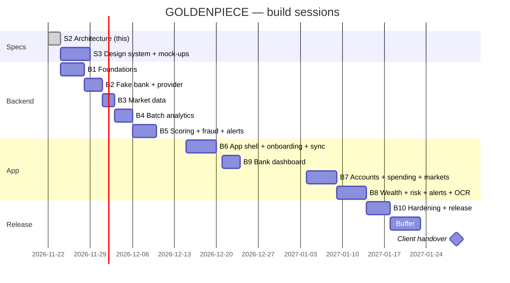

# Build plan — GOLDENPIECE prototype (Session 2)

Franco gave no demo date; the brief asks the architecture agent to set
it. **Proposed deadline: client build handed over on Friday 2027-01-29**
(release candidate 2027-01-22, one buffer week).

Assumptions behind the date [mine]:
- ≈ 3 build sessions per week, each a Claude session of about one day
  of work, with Franco reviewing/merging within one day.
- Reduced pace 2026-12-21 → 2027-01-03 (holidays): one small session.
- Franco does the SETUP tasks on time (RTT before B1, phone specs before
  B6, accounts before each session that needs them).
- Each session ends with a PR to `main`; the next session starts from
  merged `main`. A session that slips moves the deadline by its delay
  unless the slack below absorbs it.

---

## 1. Timeline

Critical path: **S3 → B6 → B7 → B8 → B10**. Backend sessions B1-B5 run
while design is in progress; B9 fits the holiday slot.

---

## 2. Sessions

Each row: scope, what must exist before, what Franco does, done
criteria. "Account" refers to [SETUP.md](SETUP.md) §3.

### S3 — Design (design agent) · 2026-11-24 → 2026-11-28

| Item | Content |
|---|---|
| Input | [BRIEF_03_DESIGN.md](BRIEF_03_DESIGN.md) + this folder |
| Output | design tokens (light/dark), components, all screens and states, motion, tour script, push texts FR/EN, icons, chart styles |
| Franco | validates the mock-ups |
| Done | every screen of BRIEF_03 §3 has its states; contrast script passes; Franco validated |

### B1 — Foundations · 2026-11-24 → 2026-11-27

| Item | Content |
|---|---|
| Scope | monorepo skeleton (ARCHITECTURE §10.2), CI `ci.yml` + `deploy-dev.yml`, Supabase dev + demo projects, schemas + all tables of DATA_MODEL §2 as migrations, RLS + pgTAP, `api` schema skeleton, money library (TS/SQL/Python) + shared fixtures, `ref` seed (countries, categories, operators, fictitious banks, BINs), JSON Schemas of payloads, `health` function |
| Before | region = eu-west-3 (RTT done); **Supabase account** (2 projects); GitHub secret scanning on |
| Franco | creates Supabase projects, adds `SUPABASE_ACCESS_TOKEN`, DB passwords as GitHub env secrets |
| Done | CI green; `supabase db push` to dev works; pgTAP RLS tests pass; money fixtures pass in 3 languages |

### B2 — Fake bank and provider · 2026-11-30 → 2026-12-02

| Item | Content |
|---|---|
| Scope | Python generator (personas, account profiles, "new wallet", 12 + 12 months, scenarios with ground truth, UEMOA/CEMAC IBAN, ISO 20022 fields, mobile-money ops, SIM-swap events), `ProviderAdapter` + `SimAdapter`, `provider-link-*`, `provider-sync`, `provider-tick` + pg_cron, `ingest` (insert + rule categorisation only), `account-demo-start/reset/cleanup`, contract tests |
| Before | B1 merged |
| Done | a demo clone is ready < 2 s; ticks deliver due entries; contract tests green; same seed = same data |

### B3 — Market data · 2026-12-03 → 2026-12-04

| Item | Content |
|---|---|
| Scope | instrument universe (30), `market-refresh`, `market-eod`, Frankfurter + FRED backfill, Twelve Data 5-year backfill, quotas counters, `api.get_markets`, `api.get_asset`, attributions |
| Before | **Twelve Data, Finnhub, CoinGecko Demo, FRED accounts** (keys put in Supabase secrets by Franco) |
| Done | quotes ≤ 30 min old in exchange hours for 3 days; quotas ≤ 50 % used; splits checked for the universe (G5) |

### B4 — Batch analytics · 2026-12-07 → 2026-12-09

| Item | Content |
|---|---|
| Scope | `batch/analytics` (portfolio_daily, networth, vol, beta, VaR/CVaR 1d + √21 + overlapping check, drawdown, exposures, TWR, IRR, attribution + currency effect), `batch-nightly.yml`, `batch-user.yml`, `dispatch-batch` via pg_cron + PAT in Vault, `api.get_risk`, `api.get_performance(_custom)`, hand-checked finance fixtures |
| Before | B2, B3; **fine-grained GitHub PAT** created by Franco (Actions: write, this repo) and stored in Supabase Vault |
| Done | nightly run ≤ 15 min; fixtures pass; custom period ≤ 300 ms on demo data |

### B5 — Scoring, fraud, alerts · 2026-12-10 → 2026-12-15

| Item | Content |
|---|---|
| Scope | features (SQL), profiles + learning status, IF training/export/parity, TS scorer, fraud rules R1-R6 **with verified official sources**, combination, alerts, reminders, `notify` (Expo push call stubbed until B8), `answer_alert`, `analyst_*` RPCs, parameter tuning + log, `simulated-analyst` (S2-4), evaluation G7, `categorise-llm` (Groq) |
| Before | **Groq account** (key in secrets) |
| Done | parity |Δ| ≤ 1e-9; G7 targets met on dev; ingest → alert row ≤ 2 s p95 (push measured in B8) |

### B6 — App shell, onboarding, sync · 2026-12-15 → 2026-12-19

| Item | Content |
|---|---|
| Scope | Expo SDK 58 dev build, navigation, i18n FR/EN, design tokens from S3, language → country → tour → demo/sign-up, Supabase Auth + SMTP, device security matrix (§1.2b), app PIN, lock, consents, questionnaire, SQLite + SQLCipher, sync engine + outbox, home screen, Sentry, min-version screen |
| Before | S3 validated; **Tecno Spark 50 specs (SETUP §2)**; **Expo account**; **Brevo account** (S2-10, free, verified sender); **Sentry account** |
| Done | cold start ≤ 3 s p50 measured on the Tecno; airplane-mode test passes on home; tour works offline |

### B9 — Bank dashboard · 2026-12-21 → 2026-12-23

| Item | Content |
|---|---|
| Scope | Vite + React SPA, analyst login + TOTP, queue (Realtime), alert detail, decision, scoring-params panel, Ops tab, `/legal` pages |
| Before | B5; **Cloudflare account** |
| Done | decision reaches the app (Realtime) and logs param changes |

### B7 — Accounts, spending, markets · 2027-01-04 → 2027-01-08

| Item | Content |
|---|---|
| Scope | link account flow, accounts, transactions (FlashList, search, filters), transaction detail, category change + rules, spending month, Sankey, budgets + 80/100 % alerts, categories editor, markets watchlist |
| Before | B6 |
| Done | 1,000-transaction list scroll ≤ 5 % dropped frames; Sankey ≥ 45 fps scrub; data ≤ 1 MB/day over a 2-day test |

### B8 — Wealth, risk, performance, alerts, push, card OCR · 2027-01-11 → 2027-01-15

| Item | Content |
|---|---|
| Scope | portfolio, add trade, real estate, debts, asset candlestick (Skia), risk, performance (+ custom), alerts centre, "C'est vous ?" flow, Realtime, push (FCM v1, channels, actions), card OCR + parser + bench screen, settings (devices, export, delete, demo reset) |
| Before | **Firebase account** (FCM credentials uploaded to Expo by Franco) |
| Done | event → push sent ≤ 5 s p95 over 50 injected events; OCR bench results recorded; APK per ABI ≤ 30 MB |

### B10 — Hardening and release · 2027-01-18 → 2027-01-21

| Item | Content |
|---|---|
| Scope | performance pass on the Tecno (all budgets of TECH_ANALYSIS §6), TalkBack + Accessibility Scanner pass, Maestro flows, legal texts FR/EN, APK pipeline + Firebase App Distribution, OTA channel, UptimeRobot, promote to demo, demo personas reset, client test script ("parcours de démo") |
| Before | **UptimeRobot account**; Firebase App Distribution enabled; Franco's offline copy of the upload keystore |
| Done | release candidate 2027-01-22 installed by Franco from the invite e-mail on the Tecno; all budgets measured and written in `docs/MEASUREMENTS.md` |

### Buffer · 2027-01-22 → 2027-01-28, handover 2027-01-29

Fixes from Franco's own test as a "client"; nothing new enters.

---

## 3. Accounts — order of creation

| When | Account (SETUP §3) | Session |
|---|---|---|
| now | GitHub repository (exists), secret scanning on | B1 |
| done 2026-11-22 | RTT test → Paris (eu-west-3) | B1 |
| before 2026-11-24 | Supabase (dev + demo projects) | B1 |
| before 2026-12-03 | Twelve Data, Finnhub, CoinGecko Demo, FRED | B3 |
| before 2026-12-07 | GitHub fine-grained PAT (Actions: write) | B4 |
| before 2026-12-10 | Groq | B5 |
| before 2026-12-15 | Expo, Brevo (S2-10), Sentry; **Tecno specs** | B6 |
| before 2026-12-21 | Cloudflare | B9 |
| before 2027-01-11 | Firebase (FCM + App Distribution) | B8 |
| before 2027-01-18 | UptimeRobot | B10 |

Rule: Franco never pastes a key in a chat; the session says which
secret name to create and where (ARCHITECTURE §9.3).

---

## 4. Phase 2 (after the client handover, not dated)

Widgets (C9), iOS build (C3, paid Apple account), Play Integrity (S2-5),
signature-based step-up (S2-6), real MTN MoMo sandbox adapter, BRVM if a
source appears, Gemini fallback for categorisation, SMS login.
