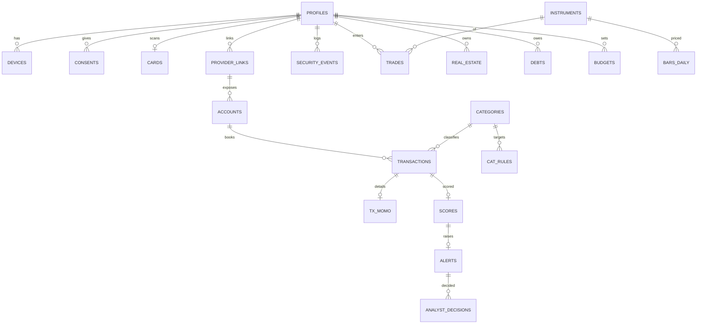

# Data model — GOLDENPIECE prototype (Session 2)

Companion of [ARCHITECTURE.md](ARCHITECTURE.md). SQL below is a
**sketch** for the build sessions (types, keys, indexes, RLS intent),
not a migration to paste. Postgres 15+ on Supabase.

Conventions:
- Money: `*_minor bigint` + `currency char(3)` (XOF/XAF exponent 0,
  EUR/USD exponent 2) — never `float` (ARCHITECTURE G3).
- Time: `timestamptz` (UTC); dates of business meaning (`value_date`,
  `valued_on`) as `date`.
- Ids: `uuid` default `gen_random_uuid()`; client-created rows carry a
  UUID v7 from the phone (idempotency).
- Mutable user rows: `row_version int`, `updated_at timestamptz` (sync
  cursor + conflict check, ARCHITECTURE §8.3).
- Schemas: `core` (user data), `ref` (reference), `mkt` (market),
  `analytics` (batch outputs), `ops` (operations), `sim` (fake bank),
  `api` (the only schema PostgREST exposes: functions and views).

---

## 1. Entity overview



---

## 2. Tables

### 2.1 Users, devices, consents (`core`)

```sql
create table core.profiles (
  user_id        uuid primary key references auth.users on delete cascade,
  is_anonymous   boolean not null default false,          -- demo clone (S2-3)
  demo_persona   text references sim.templates(id),       -- null for real users
  language       text not null check (language in ('fr','en')),
  country        char(2) not null references ref.countries(iso2),
  timezone       text not null,                           -- IANA
  ref_currency   char(3) not null default 'XOF' check (ref_currency in ('XOF','XAF','EUR','USD')),
  phone_e164     text,                                    -- fake in demo; profile field, not login (C7)
  risk_profile   smallint check (risk_profile between 1 and 5),
  hide_amounts_in_push boolean not null default true,     -- Franco
  data_saver     boolean not null default false,
  lock_delay_s   int not null default 300,
  learning_active_at timestamptz,                         -- set by batch
  last_active_at timestamptz not null default now(),
  created_at     timestamptz not null default now(),
  row_version    int not null default 1,
  updated_at     timestamptz not null default now()
);
create index on core.profiles (is_anonymous, last_active_at);   -- clone cleanup

create table core.devices (
  id              uuid primary key,                        -- random, created on device
  user_id         uuid not null references core.profiles on delete cascade,
  label           text,                                    -- "Tecno Spark 50"
  platform        text not null check (platform in ('android','ios')),
  os_version      text, app_version text not null,
  security_level  text not null check (security_level in ('strong','weak','secret','none')),
  unlock_method   text not null check (unlock_method in ('biometric_strong','biometric_weak','device_secret','app_pin')),
  push_token      text,                                    -- ExponentPushToken[…]
  push_enabled    boolean not null default false,
  created_at      timestamptz not null default now(),
  last_seen_at    timestamptz not null default now(),
  revoked_at      timestamptz
);
create index on core.devices (user_id) where revoked_at is null;

create table core.consents (
  id          bigint generated always as identity primary key,
  user_id     uuid not null references core.profiles on delete cascade,
  kind        text not null check (kind in ('service','ai_categorisation','notifications','crash_reports','terms','privacy')),
  granted     boolean not null,
  text_version text not null,                              -- ref.legal_texts version
  at          timestamptz not null default now()
);
create index on core.consents (user_id, kind, at desc);    -- latest per kind = current state

create table core.questionnaire (
  user_id   uuid not null references core.profiles on delete cascade,
  section   text not null check (section in ('income','goals','risk','habits')),
  answers   jsonb not null,                                -- schema in shared/schemas/questionnaire.json
  version   int not null,
  updated_at timestamptz not null default now(),
  primary key (user_id, section)
);

create table core.cards (                                  -- S2-1: bank identification only
  user_id   uuid primary key references core.profiles on delete cascade,
  bin6      char(6) not null check (bin6 ~ '^[0-9]{6}$'),
  last4     char(4) not null check (last4 ~ '^[0-9]{4}$'),
  brand     text not null,                                 -- visa | mastercard | amex | other
  bank_id   text references ref.banks(id),                 -- null = "banque non reconnue" until picked
  source    text not null check (source in ('ocr','manual')),
  created_at timestamptz not null default now()
);
```

### 2.2 Accounts and transactions (`core`)

```sql
create table core.provider_links (
  id          uuid primary key default gen_random_uuid(),
  user_id     uuid not null references core.profiles on delete cascade,
  adapter     text not null,                               -- 'sim' | 'mtn_momo_sandbox'
  institution text not null,                               -- 'bank_demo_sn' | 'orange' | 'wave' | 'mtn'
  scopes      text[] not null,
  status      text not null check (status in ('active','expired','revoked')),
  history_days int not null,
  created_at  timestamptz not null default now()
);

create table core.accounts (
  id           uuid primary key default gen_random_uuid(),
  user_id      uuid not null references core.profiles on delete cascade,
  link_id      uuid references core.provider_links on delete cascade,  -- null = manual cash account
  kind         text not null check (kind in ('bank','momo','cash')),
  provider_account_id text,                                 -- id at the provider
  display_name text not null,                               -- "Compte courant", "Orange Money"
  currency     char(3) not null,
  -- bank
  iban         text,  bic text, bank_id text references ref.banks(id),
  -- momo
  operator     text,  msisdn_masked text,                   -- "+221 77 ••• •• 67"
  balance_minor bigint, balance_at timestamptz,
  last_sync_at timestamptz,
  history_available boolean not null default true,          -- false for adapters without statements
  unique (link_id, provider_account_id)
);
create index on core.accounts (user_id);

create table core.transactions (                            -- camt.053 Ntry + TxDtls, flattened
  id             uuid primary key default gen_random_uuid(),
  user_id        uuid not null references core.profiles on delete cascade,
  account_id     uuid not null references core.accounts on delete cascade,
  provider_entry_id text not null,
  status         text not null check (status in ('BOOK','PDNG','RJCT')),
  cdt_dbt_ind    text not null check (cdt_dbt_ind in ('CRDT','DBIT')),
  amount_minor   bigint not null check (amount_minor >= 0),
  currency       char(3) not null,
  booking_ts     timestamptz not null,
  value_date     date not null,
  btc_domain     text, btc_family text, btc_subfamily text,  -- BkTxCd, e.g. PMNT/ICDT/ESCT
  end_to_end_id  text, tx_id text, acct_svcr_ref text,
  cp_name        text, cp_iban text, cp_msisdn text, cp_bic text, cp_merchant_code text,
  cp_key         text not null,                             -- normalised counterparty key (profiles, rules)
  remittance_info text,                                     -- Ustrd
  purpose_code   text,
  charges_minor  bigint, charges_currency char(3),
  category_id    text references ref.categories(id),        -- or core.user_categories via text id 'u:<uuid>'
  category_source text check (category_source in ('user_rule','keyword','ai','user','none')),
  category_version int not null default 0,
  ingested_at    timestamptz not null default now(),        -- start of the 5 s budget
  row_version    int not null default 1,
  updated_at     timestamptz not null default now(),
  unique (account_id, provider_entry_id)
);
create index on core.transactions (user_id, booking_ts desc);
create index on core.transactions (account_id, booking_ts desc);
create index on core.transactions (user_id, cp_key, booking_ts desc);     -- features f1, f3, f13
create index on core.transactions (user_id, updated_at, id);              -- sync cursor
create index on core.transactions (user_id, category_id, booking_ts) where status = 'BOOK';
create index on core.transactions (category_source) where category_source = 'none';  -- Groq backlog

create table core.tx_momo (                                 -- mobile-money extension, 1:1
  transaction_id uuid primary key references core.transactions on delete cascade,
  operator       text not null,
  op_type        text not null check (op_type in ('cash_in','cash_out','p2p_in','p2p_out','merchant','bill','airtime','bank_in','bank_out','fee','reversal')),
  agent_id       text,
  balance_after_minor bigint,
  operator_ref   text not null
);

create table core.security_events (
  id         uuid primary key default gen_random_uuid(),
  user_id    uuid not null references core.profiles on delete cascade,
  device_id  uuid references core.devices,
  type       text not null check (type in ('login','login_failed','new_device','device_security_changed',
               'pin_failed','sign_out','sign_out_all','password_changed','email_changed','settings_changed',
               'sim_swap','device_revoked','export','mfa_enabled')),
  source     text not null check (source in ('app','server','sim')),   -- 'sim' = fake operator signal (C8)
  at         timestamptz not null default now(),                       -- server time (G4)
  ip_country char(2),
  details    jsonb not null default '{}'
);
create index on core.security_events (user_id, at desc);
```

### 2.3 Wealth (`core`)

```sql
create table core.trades (
  id           uuid primary key,                            -- client UUID v7
  user_id      uuid not null references core.profiles on delete cascade,
  instrument_id text not null references mkt.instruments(id),
  side         text not null check (side in ('buy','sell')),
  trade_date   date not null,
  quantity     numeric(28,10) not null check (quantity > 0),
  price_minor  bigint not null, currency char(3) not null,   -- price in instrument currency
  fees_minor   bigint not null default 0,
  source       text not null check (source in ('manual','demo')),
  created_at   timestamptz not null default now()
);
create index on core.trades (user_id, instrument_id, trade_date);

create table core.corporate_actions (                         -- G5
  id uuid primary key default gen_random_uuid(),
  user_id uuid references core.profiles on delete cascade,      -- null = global (seeded)
  instrument_id text not null references mkt.instruments(id),
  kind text not null check (kind in ('split','cash_dividend')),
  ex_date date not null, ratio numeric(12,6), amount_minor bigint, currency char(3)
);

-- positions: view (weighted-average cost, realised P&L), not a table
create view core.positions_v as …;   -- per user, instrument: qty, avg_cost_minor, realised_pnl_minor

create table core.real_estate (
  id uuid primary key, user_id uuid not null references core.profiles on delete cascade,
  name text not null, country char(2), currency char(3) not null,
  row_version int not null default 1, updated_at timestamptz not null default now()
);
create table core.real_estate_valuations (                    -- append-only (conflict rule)
  id uuid primary key, real_estate_id uuid not null references core.real_estate on delete cascade,
  value_minor bigint not null, valued_on date not null, created_at timestamptz not null default now()
);

create table core.debts (
  id uuid primary key, user_id uuid not null references core.profiles on delete cascade,
  name text not null, lender text, currency char(3) not null,
  principal_minor bigint not null, balance_minor bigint not null, annual_rate_bp int,  -- basis points
  monthly_payment_minor bigint, start_date date, end_date date,
  row_version int not null default 1, updated_at timestamptz not null default now()
);
```

### 2.4 Spending (`ref` + `core`)

```sql
create table ref.categories (                                 -- default tree, FR/EN names
  id text primary key,                                        -- 'food', 'food.groceries'
  parent_id text references ref.categories(id),
  name_fr text not null, name_en text not null,
  icon text not null, is_fixed_charge boolean not null default false,
  is_income boolean not null default false, sort int not null
);
create table core.user_categories (                           -- user-added sub-categories / renames
  id uuid primary key, user_id uuid not null references core.profiles on delete cascade,
  parent_id text not null, name text not null, icon text, hidden boolean not null default false,
  row_version int not null default 1, updated_at timestamptz not null default now()
);
create table core.cat_rules (                                 -- user rules (+ global keyword rules with user_id null)
  id uuid primary key, user_id uuid references core.profiles on delete cascade,
  match_field text not null check (match_field in ('cp_key','remittance','merchant_code','op_type')),
  match_type text not null check (match_type in ('equals','contains','regex')),
  pattern text not null, category_id text not null,
  priority int not null default 100, source text not null check (source in ('user','keyword')),
  created_from_tx uuid, row_version int not null default 1, updated_at timestamptz not null default now()
);
create index on core.cat_rules (user_id, priority);

create table core.budgets (
  id uuid primary key, user_id uuid not null references core.profiles on delete cascade,
  category_id text not null, amount_minor bigint not null, currency char(3) not null,
  recurring boolean not null default true, month date,          -- month set = override for that month
  notified_80 date, notified_100 date,                          -- last month notified
  row_version int not null default 1, updated_at timestamptz not null default now(),
  unique (user_id, category_id, month)
);
-- api.budget_status view: spent this month per budget (SQL, user TZ month boundaries)
```

### 2.5 Market (`mkt`)

```sql
create table mkt.instruments (
  id text primary key,                     -- 'SPY', 'BTC', 'EURUSD', 'PCOCOUSDM'
  name text not null, asset_class text not null check (asset_class in ('equity','etf','crypto','commodity','fx','index_proxy')),
  currency char(3) not null, country char(2), sector text,
  proxy_of text,                           -- 'S&P 500' when ETF proxy (C4)
  vendor text not null,                    -- 'twelvedata' | 'finnhub' | 'coingecko' | 'fred' | 'frankfurter'
  vendor_symbol text not null,
  frequency text not null check (frequency in ('intraday','daily','monthly')),
  benchmark_id text references mkt.instruments(id),   -- beta (idea 6): SPY for equities, BTC for crypto
  in_risk boolean not null default true,  -- false for monthly series (C4)
  exchange_tz text, open_local time, close_local time
);
create table mkt.quotes_latest (
  instrument_id text primary key references mkt.instruments,
  price numeric(20,8) not null, change_pct numeric(9,4), as_of timestamptz not null,
  fetched_at timestamptz not null, vendor text not null
);
create table mkt.bars_daily (
  instrument_id text not null references mkt.instruments, d date not null,
  o numeric(20,8), h numeric(20,8), l numeric(20,8), c numeric(20,8) not null, v numeric(24,4),
  primary key (instrument_id, d)
);
create table mkt.fx_daily (                 -- base EUR, Frankfurter (G6)
  d date not null, quote char(3) not null, rate numeric(20,10) not null,
  primary key (d, quote)
);
create table mkt.fx_latest (quote char(3) primary key, rate numeric(20,10) not null, as_of timestamptz not null);
create table mkt.version (id int primary key default 1, etag text not null, updated_at timestamptz not null);
-- XOF and XAF never stored: rate = 655.957 per EUR (exact, in code and in api.fx_rate()).
```

### 2.6 Scoring, alerts, bank (`core`, `ref`, `ops`, `analytics`)

```sql
create table ref.fraud_rules (
  id text not null, version int not null,                      -- 'R1', 1
  scheme text not null, name_fr text not null, name_en text not null,
  explanation_fr text not null, explanation_en text not null,  -- user-facing reason template
  params jsonb not null, weight smallint not null,
  w_min smallint not null, w_max smallint not null,
  source_title text not null, source_url text not null, source_date date not null,
  active boolean not null default true, valid_from timestamptz not null default now(),
  primary key (id, version)
);

create table core.scores (
  id uuid primary key default gen_random_uuid(),
  user_id uuid not null references core.profiles on delete cascade,
  transaction_id uuid references core.transactions on delete cascade,
  security_event_id uuid references core.security_events on delete cascade,
  total smallint not null check (total between 0 and 100),
  band text not null check (band in ('none','ask','bank')),
  a_thr real not null, a_if real not null, f real not null, m real not null,
  learning boolean not null,
  features jsonb not null, reasons jsonb not null,             -- [{code, params, weight}]
  model_version text, rules_version text not null, params_version int not null,
  latency_ms int not null, computed_at timestamptz not null default now()
);
create index on core.scores (user_id, computed_at desc);

create table core.alerts (
  id uuid primary key default gen_random_uuid(),
  user_id uuid not null references core.profiles on delete cascade,
  kind text not null check (kind in ('anomaly','fraud','budget','concentration','learning_done')),
  score_id uuid references core.scores,
  transaction_id uuid references core.transactions on delete set null,
  score smallint, band text check (band in ('ask','bank','info')),
  status text not null check (status in ('open','awaiting_user','confirmed_by_user','escalated',
           'in_review','decided_legit','decided_fraud','closed')),
  reasons jsonb not null,                                       -- codes + params, rendered by the app in FR/EN
  bank_id text references ref.banks(id),
  user_answer text check (user_answer in ('me','not_me')), answered_at timestamptz,
  reminder_sent_at timestamptz, escalated_at timestamptz, push_sent_at timestamptz,
  created_at timestamptz not null default now(),
  row_version int not null default 1, updated_at timestamptz not null default now()
);
create index on core.alerts (user_id, created_at desc);
create index on core.alerts (status, created_at) where status in ('escalated','in_review');   -- analyst queue
create index on core.alerts (status, created_at) where status = 'awaiting_user';              -- reminders

create table core.analyst_decisions (
  id uuid primary key default gen_random_uuid(),
  alert_id uuid not null references core.alerts on delete cascade,
  analyst_id uuid references auth.users,                        -- null when simulated (S2-4)
  decision text not null check (decision in ('fraud','legit')),
  comment text, simulated boolean not null default false,
  decided_at timestamptz not null default now()
);

create table ops.scoring_params (
  key text not null,                     -- 'z0', 'z1', 'w:R1', 'bump:new_device'
  scope text not null check (scope in ('global','user_category')),
  user_id uuid references core.profiles on delete cascade, category_id text,
  value real not null, default_value real not null, min_value real not null, max_value real not null,
  version int not null default 1, updated_at timestamptz not null default now(),
  unique nulls not distinct (key, scope, user_id, category_id)
);
create table ops.param_changes (
  id bigint generated always as identity primary key,
  param_key text not null, user_id uuid, category_id text,
  before real not null, after real not null,
  cause text not null check (cause in ('user_me','analyst_legit','analyst_fraud','weekly_precision','reset')),
  alert_id uuid, actor uuid, at timestamptz not null default now()
);

create table analytics.behaviour_profiles (                    -- idea 8, nightly, 180-day window
  user_id uuid not null, dim text not null check (dim in ('user','category','payee','hour','weekday')),
  key text not null, n int not null,
  median_ln_amount real, mad_ln_amount real, p95_amount_minor bigint, share real,
  p95_hourly_count real, p95_daily_outflow_minor bigint,
  first_seen timestamptz, last_seen timestamptz, computed_at timestamptz not null,
  primary key (user_id, dim, key)
);
create table analytics.learning_status (
  user_id uuid primary key, first_op_at timestamptz, ops_count int not null,
  days int not null, active boolean not null, computed_at timestamptz not null
);

create table ops.model_artifacts (
  version text primary key, kind text not null check (kind = 'iforest'),
  storage_path text not null, sha256 text not null, features text[] not null,
  trained_at timestamptz not null, train_rows int not null,
  status text not null check (status in ('candidate','active','retired')),
  parity_ok boolean not null, eval jsonb
);
create table ops.model_eval (                                   -- G7
  id bigint generated always as identity primary key, model_version text, rules_version text,
  run_at timestamptz not null, precision_bank real, recall_bank real, recall_ask_or_bank real,
  false_prompts_per_user_month real, details jsonb
);
```

### 2.7 Batch outputs (`analytics`)

```sql
create table analytics.portfolio_daily (                       -- source of custom-period perf
  user_id uuid not null, d date not null, instrument_id text not null,   -- 'CASH:XOF', 'RE:<uuid>' allowed
  qty numeric(28,10) not null, price_local numeric(20,8),
  value_local_minor bigint not null, value_ref_minor bigint not null,   -- ref = user's ref currency at compute time
  flow_ref_minor bigint not null default 0,                    -- external flows that day (buy +, sell −, dividend −)
  primary key (user_id, d, instrument_id)
);
create table analytics.networth_daily (
  user_id uuid not null, d date not null, ref_currency char(3) not null,
  assets_minor bigint not null, liabilities_minor bigint not null, net_minor bigint not null,
  by_class jsonb not null,                                    -- {"cash":…, "momo":…, "equity":…}
  primary key (user_id, d)
);
create table analytics.risk_metrics (
  user_id uuid not null, as_of date not null, metric text not null,
  -- 'vol_ann','beta','var95_1d','cvar95_1d','var95_1m','cvar95_1m','var95_1m_hist','max_drawdown'
  scope text not null default 'portfolio',                    -- or instrument id
  value numeric(20,8), value_ref_minor bigint, n_obs int not null,
  method text not null, status text not null check (status in ('ok','insufficient','excluded')),
  primary key (user_id, as_of, metric, scope)
);
create table analytics.drawdown_series (user_id uuid, d date, drawdown real not null, primary key (user_id, d));
create table analytics.exposures (
  user_id uuid not null, as_of date not null, axis text not null check (axis in ('class','currency','country','sector')),
  key text not null, value_ref_minor bigint not null, share real not null,
  primary key (user_id, as_of, axis, key)
);
create table analytics.performance (
  user_id uuid not null, period text not null check (period in ('1M','YTD','1Y','ITD')),
  as_of date not null, start_d date not null, twr real, irr real, annualised boolean not null,
  pnl_ref_minor bigint, status text not null, primary key (user_id, period, as_of)
);
create table analytics.attribution (
  user_id uuid not null, period text not null, as_of date not null,
  level text not null check (level in ('instrument','class')), key text not null,
  avg_weight real not null, return_local real, return_ref real,
  contribution real not null, currency_effect real not null,
  primary key (user_id, period, as_of, level, key)
);
```

### 2.8 Simulated bank (`sim`)

```sql
create table sim.templates (
  id text primary key,                     -- 'persona_dakar_salaried', 'sn_bank_a', 'new_wallet'
  kind text not null check (kind in ('persona','account_profile')),
  profile_id text not null,                -- 'SN','CI','CM','UEMOA','CEMAC','AFRICA','DIASPORA'
  description text not null, generator_version text not null, seed int not null
);
create table sim.template_accounts (
  template_id text references sim.templates, key text,       -- 'bank', 'orange', 'wave'
  kind text not null, institution text not null, currency char(3) not null,
  opening_balance_minor bigint not null, primary key (template_id, key)
);
create table sim.template_entries (                          -- past AND future, as offsets
  template_id text not null, account_key text not null, seq int not null,
  offset_s bigint not null,                -- seconds relative to anchor (negative = past)
  entry jsonb not null,                    -- ProviderEntry without ids/dates (ARCHITECTURE §3.1)
  scenario_tag text,                       -- 'R1_sim_swap', 'anomaly_amount', null = normal
  expected_band text,                      -- ground truth for G7 and simulated analyst
  primary key (template_id, account_key, seq)
);
create index on sim.template_entries (template_id, offset_s);
create table sim.template_security_events (
  template_id text, seq int, offset_s bigint not null, type text not null, details jsonb,
  scenario_tag text, primary key (template_id, seq)
);
create table sim.links (                                      -- one per linked template account
  link_id uuid primary key references core.provider_links on delete cascade,
  template_id text not null references sim.templates, account_keys text[] not null,
  anchor_at timestamptz not null,          -- entry time = anchor_at + offset_s
  delivered_until timestamptz not null     -- tick watermark
);
create index on sim.links (delivered_until);
```

**Built in B2 (additions to the sketch above):** `sim.templates.timezone`,
`sim.templates.country`; `sim.template_entries.cum_minor` (signed running sum
per account, gives `balanceAfterMinor` without summing at read time) + index
`(template_id, account_key, offset_s)`; `sim.template_wealth(template_id, seq,
item jsonb)` (debts, real estate, demo trades of a persona); per-link extras
`sim.link_entries` / `sim.link_security_events` (seq ≥ 1000000: the
first-session guarantee). Template security events carry
`details.accountKey`. `core.provider_links` gains status `pending`,
`template_id` (sim only) and `options`; simulated security events are unique
per `(user_id, details->>'provider_event_id')`. Template volume (generator
b2.1): 10 templates, 10 327 entries (≈ 3.4 MB of JSON), far below the 56 k
row estimate of §4. A demo clone copies 350-1 500 past entries.

### 2.9 Reference and operations (`ref`, `ops`)

```sql
create table ref.countries (iso2 char(2) primary key, name_fr text, name_en text, dial_code text,
  default_tz text, timezones text[], profile_id text not null, privacy_notice_key text not null,
  operators text[] not null default '{}');
create table ref.operators (id text primary key, name text not null, logo_path text);
create table ref.banks (id text primary key, name text not null, country char(2), bic text,
  iban_bank_code text, is_fictitious boolean not null default true);
create table ref.card_bins (bin6 char(6) primary key, bank_id text references ref.banks, brand text);
create table ref.legal_texts (kind text, lang text, version text, body_md text, published_at timestamptz,
  primary key (kind, lang, version));

create table ops.app_config (key text primary key, value jsonb not null);   -- min_version, feature flags
create table ops.job_runs (id bigint generated always as identity primary key, job text not null,
  started_at timestamptz not null, finished_at timestamptz, status text not null, items int,
  detail jsonb, error text);
create index on ops.job_runs (job, started_at desc);
create table ops.audit_log (id bigint generated always as identity primary key, at timestamptz not null default now(),
  actor uuid, actor_role text not null, action text not null, target text, detail jsonb);
create table ops.rate_limits (key text primary key, tokens real not null, refreshed_at timestamptz not null);
create table ops.idempotency (client_id uuid primary key, user_id uuid not null, rpc text not null,
  result jsonb not null, at timestamptz not null default now());
create table ops.recompute_queue (user_id uuid primary key, reason text, requested_at timestamptz not null default now());
create table ops.push_log (id bigint generated always as identity primary key, user_id uuid, alert_id uuid,
  kind text, ticket_id text, status text, sent_at timestamptz not null default now());
```

---

## 3. RLS policies per table

`u` = `(select auth.uid())`; `analyst()` = `auth.jwt()->'app_metadata'->>'role' = 'analyst' and auth.jwt()->>'aal' = 'aal2'`.
PostgREST exposes **only `api`**; RLS is still on every table (defence
in depth, and for Realtime, which reads `core.alerts` directly).

| Table | user (authenticated) | analyst | batch_writer | Notes |
|---|---|---|---|---|
| core.profiles | select/update own (`user_id = u`), no insert (created by trigger on auth.users), no delete | via RPC: country, created_at of escalated users | select | |
| core.devices | select own; insert own; update own `push_token, last_seen_at, security_level`; revoke via RPC | via RPC (escalated) | — | |
| core.consents | select/insert own; no update/delete (history) | — | — | |
| core.questionnaire | all own | — | select | |
| core.cards | select/insert/update own | via RPC: bank only | — | no PAN exists anywhere |
| core.provider_links, accounts | select own; writes by functions only | via RPC (escalated) | select | |
| core.transactions, tx_momo | select own; update own `category_*` via RPC only | via RPC: transactions of escalated alerts' users, last 90 days | select | |
| core.security_events | select own; insert only through RPC (type whitelist from app) | via RPC (escalated) | select | `sim` and `server` events by functions |
| core.trades, real_estate*, debts, corporate_actions | all own (insert/update/delete own) | — | select | |
| core.user_categories, cat_rules, budgets | all own; global keyword rules (`user_id is null`) readable by all | — | select | |
| core.scores | select own (reasons only through RPC) | via RPC | select | |
| core.alerts | select own (**Realtime channel**); update through `api.answer_alert` only | select where `status in ('escalated','in_review','decided_*')`; update through `api.analyst_decide` | select; insert concentration/learning alerts | |
| core.analyst_decisions | select own alerts' decisions (decision + date, no analyst id) | insert/select | select | |
| ref.* | select all (incl. anon for countries, legal texts) | select | select | writes by migrations |
| mkt.* | select (through `api.get_markets`) | select | select; write via functions | |
| analytics.* | select own (through RPCs) | — | insert/update/delete | |
| ops.scoring_params, param_changes, model_*, job_runs | — | select (Ops tab) | write | |
| ops.audit_log | — | select | insert only | no update/delete grants |
| ops.rate_limits, idempotency, recompute_queue, push_log, app_config | — (app_config through `api.bootstrap`) | — | select | |
| sim.* | **none** | none | select/write (generator) | provider functions only (service role) |

pgTAP (`supabase/tests/rls_*.sql`): for each `core` table, user A
cannot select/update user B's row; analyst without aal2 gets 0 rows;
anonymous demo user cannot read another clone; `anon` sees only ref
tables listed.

---

## 4. Size estimate (500 MB limit)

Demo load: 15 real users + 40 demo clones = 55 users (ARCHITECTURE §0).

| Table group | Rows | Bytes/row incl. indexes [assumed] | Size |
|---|---|---|---|
| core.transactions (55 users × 3 accounts × ~13 months × 60) | 130 k | 700 | 91 MB |
| core.tx_momo (2/3 of rows) | 87 k | 120 | 10 MB |
| core.scores (debits, 180-day retention) | 40 k | 400 | 16 MB |
| sim.template_entries (13 templates × 3 accounts × 24 months × 60) | 56 k | 400 | 22 MB |
| analytics.portfolio_daily (30 users with portfolios × 730 days × 10 instruments) | 219 k | 90 | 20 MB |
| analytics.networth_daily (55 × 730) | 40 k | 150 | 6 MB |
| mkt.bars_daily (30 × 1,500) + fx_daily (5 × 2,000) | 55 k | 80 | 4 MB |
| behaviour_profiles, learning_status | 12 k | 150 | 2 MB |
| security_events, alerts, decisions | 20 k | 250 | 5 MB |
| risk, exposures, performance, attribution, drawdown | 60 k | 80 | 5 MB |
| ops (job_runs 90 d, audit, push_log, params, idempotency 7 d) | 30 k | 200 | 6 MB |
| ref (countries, categories, rules, banks, BINs, legal texts) | 5 k | — | 2 MB |
| Postgres + Supabase baseline (catalogs, auth, extensions, bloat) | — | — | 30 MB [assumed] |
| **Total** | | | **≈ 220 MB → 56 % headroom** |

Storage (1 GB, separate): IF models 5 versions × 2.5 MB + exports
(deleted after 24 h) < 50 MB.

Growth: each extra **active** user ≈ 1.8 MB/year; the 50 % headroom
holds up to ≈ 70 extra users. If the DB passes 300 MB, the `health`
check warns and clone cleanup drops to 3 days.

---

## 5. Retention

| Data | Kept | Job |
|---|---|---|
| Real users' transactions, trades, real estate, debts, budgets, rules | until account deletion | — |
| Demo clones (anonymous users) | 7 days after `last_active_at` | nightly `account-cleanup` |
| core.scores | 180 days (alerts keep their reasons) | nightly |
| core.security_events | 180 days | nightly |
| alerts, analyst decisions | until account deletion | — |
| mkt.bars_daily | 6 years | — |
| mkt.quotes_latest | latest only (upsert) | — |
| analytics.* | portfolio/networth 2 years; others latest 2 `as_of` + monthly ends | nightly |
| ops.job_runs | 90 days | nightly |
| ops.audit_log | 2 years | monthly |
| ops.idempotency | 7 days | nightly |
| ops.push_log | 30 days | nightly |
| Exports in Storage | 24 h | hourly |
| IF models | last 5 versions | weekly |
